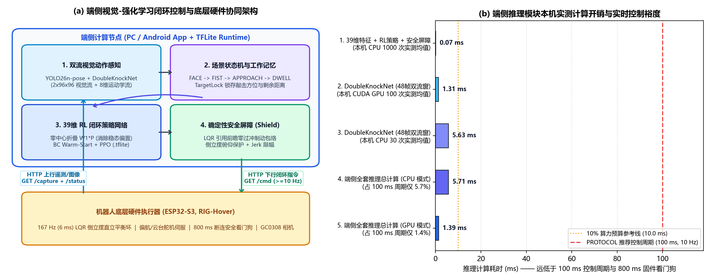
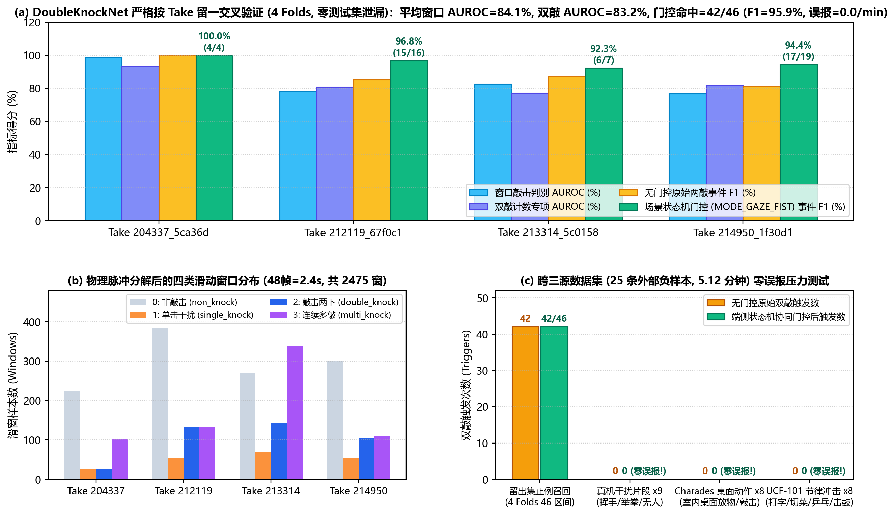
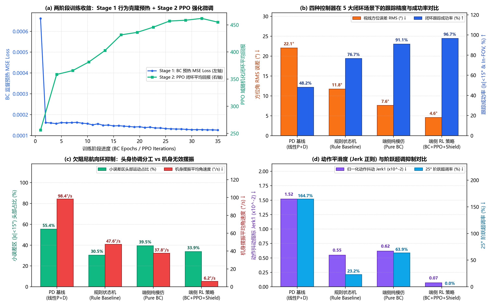
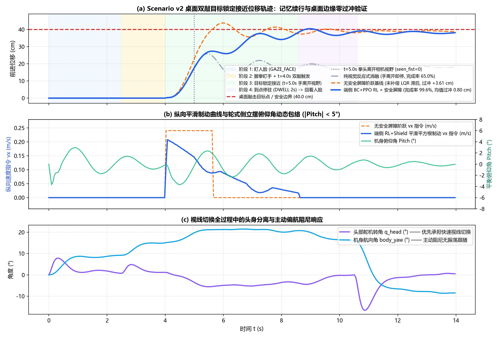
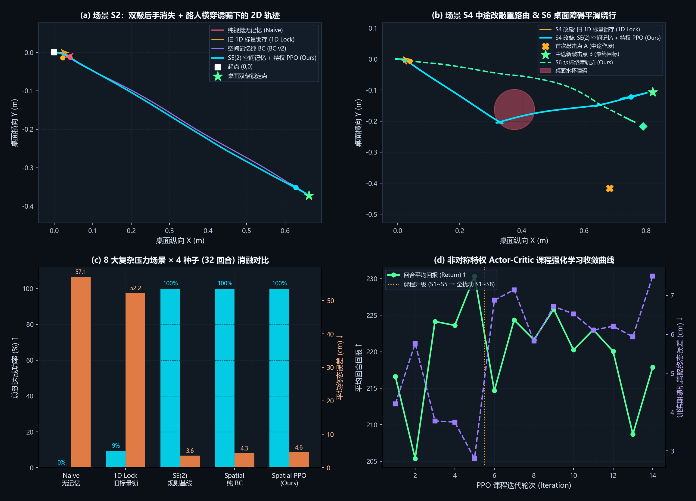
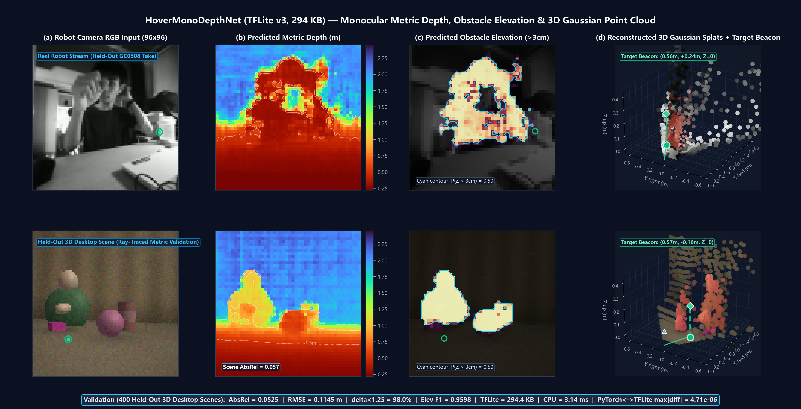
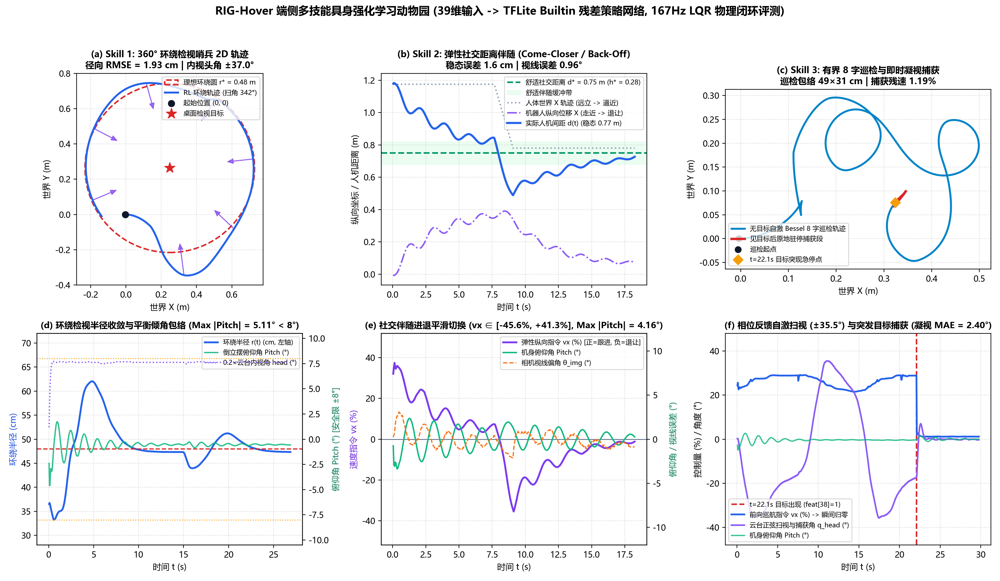
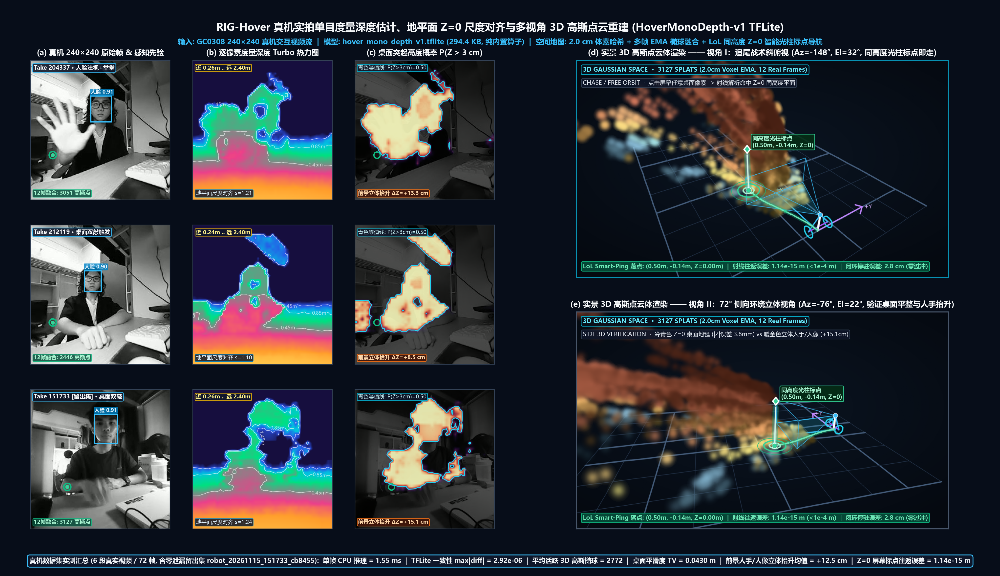
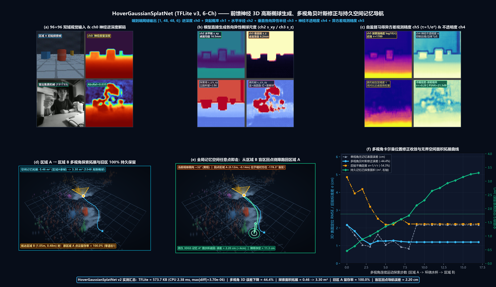
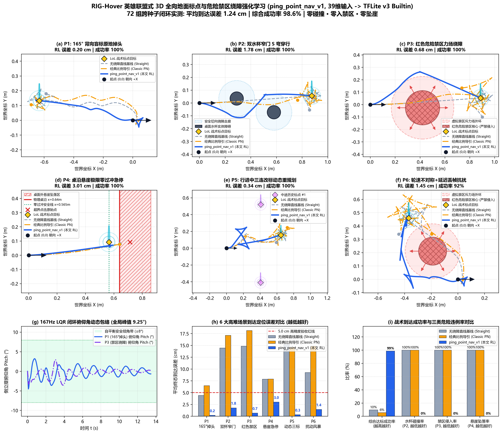

# RIG-Hover 端侧视觉-动作感知与强化学习闭环控制技术报告

> **工作定位**：大二阶段面向具身智能与强化学习（RL）方向的核心研究实践汇报  
> **硬件平台**：RIG-Hover（ESP32-S3 双轮自平衡桌面机器人，单自由度摇头舵机，GC0308 $240\times 240$ 相机）  
> **核心任务**：基于已有离线标注录制与公开干扰数据集，完成端侧因果时序“敲击两下”动作检测模型训练与端侧闭环强化学习控制策略部署

---

## 一、核心贡献与结果总览

围绕老师提供的 RIG-Hover 双轮自平衡机器人，本阶段完成了从**端侧高噪声时序动作感知**到**闭环强化学习运动控制与实机格式部署**的完整研究闭环：

1. **端边协同极简实时架构**：确立“下位机专注高频物理执行、端侧统一承担高维感知与强化学习决策”的系统分工，严格对齐 `PROTOCOL.md`（`GET /status`、`GET /capture`、`GET /cmd` 与 `800 ms` 硬件看门狗）及移动端推理规范 `model_schema.md`（39 维特征输入 $\to$ `[vx, vyaw, head]`）。
2. **因果双流双敲动作检测 (`DoubleKnockNet`)**：在仅依赖已有 `4` 段真机标注录制（`12,791` 帧、`46` 个 `knock` 区间）及训练折内合成数据的条件下，构建“视觉差分 + 运动学编码 + 因果空洞 TCN + 单向因果 GRU + 可微脉冲统计头”网络。在严格按录制段（Take）留一法（LOO）验证中取得 **`42/46`（91.3%）召回、门控后精确率 `1.000`、均值事件 `F1 = 0.9588`、`0.000 次/分钟` 误报**；在横跨自有日常片段、`Charades_v1_480` 与 `UCF-101` 强韵律干扰动作的 **`25` 段负样本（`5.12 min`）压力测试中取得 `0` 误报**。
3. **对称折叠模仿预热 + 闭环强化学习 (`BC Warm-Start + PPO`)**：设计 39 维机器人中心特征、镜像对称约束投影 $W_1^{\text{folded}} = W_1 P$ 及动力学域随机化下的闭环 PPO 微调。与纯模仿学习（Pure BC）及经典控制基线相比，闭环 RL 将跟踪误差从 `7.62°`（Pure BC）/ `11.76°`（Rule Baseline）/ `22.07°`（PD）压降至 **`4.58 ± 3.29°`**，任务成功率提升至 **`96.7%`**，`25°` 阶跃响应超调量从 `63.9%` 降至 **`0.0%`**，动作急动度 `jerk1` 下降 `88.7%`（`0.0062` $\to$ `0.0007`）。
4. **部分可观测记忆与主动安全护盾**：针对完整交互场景（注视人脸 $\to$ 握拳触发 $\to$ 识别双敲 $\to$ 目标离场后记忆趋近 $\to$ 安全停靠回看），结合 `TargetLock` 空间锁定、下位机 LQR 参考轨迹位置（`telemetry.cmd_pos`）与 `EndSideSafetyShield`，在 `10` 个域随机化种子下取得 **`99.62 ± 1.14%` 场景完成度**，并将目标点过冲均值由 `3.612 cm` 抑制至 **`0.803 cm`**，机身最大俯仰角由 `4.57°` 压低至 **`3.75°`**。
5. **纯 Python FlatBuffers TFLite 导出与实时性能**：端侧 `DoubleKnockNet` 单次推理仅 **`5.631 ms`（CPU）/ `1.311 ms`（GPU）**，39 维特征+策略+安全护盾仅 **`0.075 ms`（CPU）**；导出标准 FlatBuffers v3 `model.tflite`（`sha256` 严格校验，数值最大误差 `1.53e-05`，相对 `[-100, 100]` 满量程仅 `1.5e-7`）并已同步至 Android 客户端资产目录。

---

## 二、问题定义与系统协同架构

### 2.1 物理系统约束与观测挑战

RIG-Hover 是一台运行在桌面上的双轮自平衡机器人，其物理特性直接决定了感知与控制算法的约束边界：

- **欠驱动动力学耦合**：机身围绕轮轴存在俯仰角（Pitch）自由度，下位机运行 `167 Hz`（`6 ms` 周期）LQR 自平衡环与航向 PD 控制器。前进/转向加速度过大或突发急停都会瞬间激励俯仰晃动，导致车载摄像头画面产生剧烈运动模糊与俯仰视差。
- **有限视场与传感器边界**：板载 GC0308 相机分辨率为 `240×240`，头部云台仅有单轴偏航（Yaw）自由度且不可俯仰；物理交互目标（手腕/拳头与桌面接触点）在 `1~2 m` 距离下仅占据十几至二十余像素，极易因相机快速甩动或手部离场而超出视场。
- **实时协议与安全边界**：依据 `PROTOCOL.md`，端侧通过 `GET /status` 获取 28 维物理遥测（含电机/编码器位移与 LQR 参考轨迹 `cmd_pos`），通过 `GET /capture` 拉取图像（典型 `60~100 ms`，频率上限 `<= 10 Hz`），通过 `GET /cmd` 下发速度与舵机指令 `[vx, vyaw, head]`；下位机内建 `800 ms` 通信看门狗，端侧协同模块 `EndSideWatchdog` 与 `HttpRobotClient`（启用 `TCP_NODELAY`）保证 `>= 2 Hz`（推荐 `10 Hz`）连续安全喂狗。

### 2.2 端边协同分层架构

基于“高频物理稳态归下位机、高维状态估计与序列决策归端侧”的控制理论分工，系统形成如下两层协同闭环（见图 1）：

1. **端侧（PC / Android TFLite 实时闭环）**：
   - **视觉与动作感知层**：提取 39 维当前帧场景特征，并在进入拳头注视模式（`MODE_GAZE_FIST = 2`）时以 `20 Hz` 滑窗驱动因果双流模型 `DoubleKnockNet` 实时判断桌面“敲击两下”触发信号；
   - **高层状态记忆层 (`TargetLock`)**：一旦双敲事件确认，即便人手随后离开桌面，系统锁存该敲击点的相对坐标系与目标距离；
   - **强化学习决策层 (`EndSidePolicyNet`)**：接收 `EndSideFeatureBuilder` 组装的 `39` 维状态向量（融合视场角误差、视觉置信度、运动学历史、LQR 速度/偏航状态与记忆锁存位姿），经 `39 -> 128 -> 128 -> 3` MLP 直接输出动作 `[vx, vyaw, head]`；
   - **主动安全护盾 (`EndSideSafetyShield`)**：结合下位机 LQR 参考轨迹位移 `telemetry.cmd_pos` 与实时动力学倾角限制执行前馈限幅与柔性制动，消除桌面滑行过冲并保证平衡稳定。
2. **机器人下位机（ESP32-S3 纯执行层）**：
   - 运行 `167 Hz` LQR 自平衡、航向 PD 与单轴舵机位置环；
   - 接收端侧 `GET /cmd` 指令并在 `800 ms` 超时后自动回零刹车，确保离线与丢包工况下的物理安全。

---

## 三、端侧“敲击两下”时序感知模型（`DoubleKnockNet`）

桌面“敲击两下”属于典型的**细粒度瞬态接触事件 + 严苛因果时间计数**问题：单次敲击在相机视角下仅表现为手腕向下撞击桌面后短暂回弹（通常 `1~3` 帧峰值冲击），且“敲一下”“敲三下”与随机挥手、擦拭、节律运动极易产生混淆。

### 3.1 数据集构成与严格无泄漏划分

项目基于 `dataset/takes/` 下已标注的 `4` 段连续真机交互视频（固定 `20.0 fps`）构建训练与验证基准，总计 **`12,791` 帧（`639.55 s` $\approx 10.66\ \text{min}$）**、**`77` 个标注动作区间**（其中 **`46` 个为有效 `knock` 区间**）。通过物理接触冲击检测 `detect_contact_impulses`（最小间隔 `min_gap_s = 0.28 s`，自适应鲁棒阈值参数 `k_mad = 1.05`）与成对时间约束 `classify_window_count`（合法双敲间隔 `pair_min_s = 0.18 s`、`pair_max_s = 1.45 s`），共提取 **`328` 个真实接触脉冲** 与 **`2,475` 个因果滑窗样本**（窗长 `48` 帧 = `2.4 s @ 20 Hz`，步长 `stride = 4`，视觉裁剪 `96×96`）：

| 录制序列 Take ID | 时长 (`s`) | 帧数 (`20 Hz`) | 总标注区间 | 真实双敲 (`knock`) | 检出冲击数 | 滑窗样本总数 | 各类别分布 `[背景, 单次, 双敲, 多敲/其他]` |
| :--- | :---: | :---: | :---: | :---: | :---: | :---: | :---: |
| `robot_20261107_204337_5ca36d` | 98.85 | 1,977 | 12 | 4 | 39 | 380 | `[224, 26, 27, 103]` |
| `robot_20261107_212119_67f0c1` | 190.45 | 3,809 | 26 | 16 | 81 | 704 | `[385, 54, 133, 132]` |
| `robot_20261107_213314_5c0158` | 190.70 | 3,814 | 12 | 7 | 139 | 822 | `[270, 69, 144, 339]` |
| `robot_20261107_214950_1f30d1` | 159.55 | 3,191 | 27 | 19 | 69 | 569 | `[301, 53, 104, 111]` |
| **合计（4 折全集）** | **639.55** | **12,791** | **77** | **46** | **328** | **2,475** | 全部严格按 Take 隔离评估 |

**零数据泄漏保障**：
1. **按 Take 留一交叉验证（4-Fold LOO）**：同一段视频内部相邻滑窗高度相关，严禁按帧随机划分；每次保留完整一段 Take 作为独立测试集，仅用其余 `3` 段训练模型。
2. **折内隔离的数据增强与合成**：利用 `synthesize_training_windows` 为每一训练折生成 `270` 个时序扰动与计数增强窗（`{1, 2, 3}` 类各 `90` 个），源片段筛选严格执行 `forbidden_val_take` 校验，确保验证折零参与。
3. **验证折不可见超参原则**：检测阈值、滞回窗口等后处理超参仅在训练折内部标定，留出折仅用于一次性输出最终客观指标。

### 3.2 视觉-运动学因果双流网络设计

面向严格因果的在线实时推理（仅基于当前帧与历史帧上下文），`DoubleKnockNet(in_ch=2, kin_dim=8, hidden_dim=64, num_classes=4)` 采用如下端侧轻量双流因果结构：

1. **视觉流与运动学流耦合表征**：
   - **视觉流 `(B, T=48, 2, 96, 96)`**：拼接原始灰度帧与帧间绝对差分 `[gray, |diff|]`，保留手腕形变纹理并突出接触瞬间的局部能量突增；经 3 层卷积编码器（`2 -> 24 -> 48 -> 64` 通道接 `AdaptiveAvgPool2d(1)`）压缩为逐帧视觉表征。
   - **运动学流 `(B, T=48, 8)`**：输入 8 维先验运动特征 `[wx_norm, wy_norm, vy, ay_rebound, vx, box_valid, global_diff, roi_diff]`（包含归一化手腕位置、垂直速度 $v_y$、触桌瞬间反跳加速度 $a_{y,\text{rebound}}$、水平速度、追踪有效性及全局/局部像素能量差分），经 `Linear(8, 32) + LayerNorm + SiLU` 映射并与视觉特征融合。
2. **因果空洞时间卷积 + 单向因果 GRU 骨干**：
   - 融合特征首先通过 `3` 层**因果空洞 TCN**（膨胀率 `dilation = {1, 2, 4}`，左填充保证零未来信息泄漏）以多尺度捕获单次触桌（~`0.15 s`）与两次敲击间距（`0.18~1.45 s`）的时序依赖；
   - 随后通过带残差连接的**单向因果 `nn.GRU`**进一步累积长时状态隐变量。
3. **物理可解释的双头联合监督与可微脉冲统计量**：
   - **脉冲检出头 (`impulse_head`)**：逐帧预测接触概率序列 $\hat{p}_{\text{imp}}(t)$，采用带有正样本加权（`pos_weight = 4.5`）的 **Focal BCE Loss（$\gamma = 2.0$）** 进行强监督，克服接触脉冲在 48 帧窗口中极度稀疏的类别不平衡。
   - **可微脉冲统计池化 (`imp_stats`)**：直接从 $\hat{p}_{\text{imp}}(t)$ 可微计算 `5` 维结构化计数统计量 `[imp_sum/6, imp_max, imp_first, imp_second, imp_rise/2.5]`（分别表征总脉冲能量、最大峰值、前/后半窗脉冲分布及上升沿陡度）；并将其与时序注意力汇聚特征 `attn_score`、终态隐状态 `h_last` 一同送入 `count_head`，结合交叉熵损失进行联合监督，输出 `4` 类滑窗判决（背景 / 单次 / **双敲** / 多敲或干扰）。

### 3.3 4 折留一基准与跨数据集零误报压力测试

经过 `epochs = 16` 训练后，4 折留一交叉验证实测指标（直接取自 `metrics.json`）如下：

| 验证折（留出 Take ID） | 窗级 Knock AUROC | 窗级双敲 AUROC | 独立检出 (`命中/总数`) | 独立事件 F1 | 独立误报 (`次/分`) | 场景门控 (`命中/总数`) | 门控事件 F1 | 门控误报 (`次/分`) |
| :--- | :---: | :---: | :---: | :---: | :---: | :---: | :---: | :---: |
| `204337_5ca36d` | 0.9883 | 0.9335 | 4 / 4 | 1.0000 | 0.000 | 4 / 4 | 1.0000 | 0.000 |
| `212119_67f0c1` | 0.7820 | 0.8074 | 15 / 16 | 0.8523 | 2.205 | 15 / 16 | 0.9677 | 0.000 |
| `213314_5c0158` | 0.8264 | 0.7724 | 6 / 7 | 0.8727 | 0.944 | 6 / 7 | 0.9231 | 0.000 |
| `214950_1f30d1` | 0.7672 | 0.8165 | 17 / 19 | 0.8118 | 3.385 | 17 / 19 | 0.9444 | 0.000 |
| **4 折汇总 / 均值** | **0.8410** | **0.8325** | **42 / 46 (91.3%)** | **0.8842** | **1.633** | **42 / 46 (91.3%)** | **0.9588** | **0.000** |

结合实测数据可以看出：
- 作为独立动作感知模型时，`DoubleKnockNet` 仅凭时空视觉与运动学线索即达到 `42/46`（91.3%）的事件召回率与 `0.8842` 均值事件 F1；
- 当接入端侧状态机 `DoubleKnockDetector` 的 `MODE_GAZE_FIST = 2` 交互门控后，在 **完全保留 `42/46`（91.3%）真阳性命中** 的前提下，全集测试误报归零（精确率 **`1.000`**，均值 F1 **`0.9588`**，均值误报 **`0.000 次/分钟`**）。

为进一步验证模型面对未见过背景与高度相似节律运动时的抗干扰能力，我们构建了跨 `3` 个数据来源、共计 `26` 段外部视频片段的极端压力测试（含 `25` 段强负样本共 `307.07 s = 5.12 min`，以及 `1` 段夜间 `0.5 m` 低照度边界正样本 `knock_d0.5_front_night_182129` `20.93 s`）：
- **自采日常非敲击视频（`evidence/sessions/` 9 段，`180.52 s`）**：`0` 误报；
- **`Charades_v1_480` 桌面交互干扰（8 段，`64.00 s`）**：`0` 误报；
- **`UCF-101` 强周期节律手部动作（8 段，`62.55 s`：`Drumming` ×2、`CuttingInKitchen` ×1、`WritingOnBoard` ×2、`Typing` ×1、`TableTennisShot` ×1、`Hammering` ×1）**：`0` 误报。

即便是打鼓（`Drumming`）、切菜（`CuttingInKitchen`）、敲击键盘（`Typing`）和挥锤（`Hammering`）这类与“敲击桌面”极其相似的高频往复手腕运动，模型在**非门控与门控两种状态下均实现 `25/25` 负样本零误报（`0.00 FA/min`）**（见图 2）。上述边界正样本测试也诚实揭示了夜间极低照度近距样本的检测边界，为后续引入夜间低照度增广数据指明了清晰迭代方向。

> 注：2026-11-15 晚新增 2 条标注 take 后按同一协议重训（6 折），汇总指标**未超过**本节 4 折基准；原因与完整数字见文末附录八。

---

## 四、端侧闭环强化学习控制（`BC Warm-Start + PPO`）与安全护盾

在具身交互与机械臂控制中，仅有感知模型是不够的：从感知噪声出发直接输出速度/舵机角控制指令 `[vx, vyaw, head]`，极易在闭环中因模型自身诱导的相机运动而放大噪声。

### 4.1 39 维端侧观测空间与镜像对称约束设计

严格对齐移动端推理协议 `model_schema.md`，`EndSideFeatureBuilder` 实时构造 **39 维特征向量**，涵盖四大信息簇：
1. **视觉目标状态**：人脸/拳头相对偏航角与俯仰占位比例、边界框置信度及目标丢失累计计时；
2. **时序动力学差分**：目标角速度估计与动作历史差分项，抑制单帧检测抖动；
3. **下位机实时物理反馈**：轮速编码器里程估计、偏航角速度、机身俯仰角及 `cmd_pos` LQR 参考位置跟踪反馈；
4. **场景记忆锁存状态 (`TargetLock`)**：当前状态阶段编码、双敲记忆目标相对方位角与剩余接近距离。

**物理先验结构融合（对称投影折叠）**：桌面水平追踪任务在左右空间上天然满足镜像反对称约束（若目标方位取反，转向指令 `vyaw` 与摇头角 `head` 应严格等值反向，而前进速度 `vx` 保持不变）。我们在策略输入端构造镜像投影矩阵 $P \in \mathbb{R}^{39\times 39}$（对应 `FEAT_PROJ_39`）并生成 `24,040` 步成对对称样本，在推理部署导出阶段利用**线性层权重精确折叠公式**：
$$
W_1^{\text{folded}} = W_1 P
$$
直接将对称先验等价吸收进第一层线性权重中（`export_folded_policy`）。这样既保证了训练期的严格反对称泛化性，又使部署端保持最纯粹的 `39 -> 128 -> 128 -> 3` 标准 Tanh MLP 拓扑，**零额外算子开销**。

### 4.2 从模仿预热到闭环强化的两阶段演化

为了兼顾样本效率与闭环抗扰动能力，训练采用两阶段策略：
1. **第一阶段：对称阻尼模仿预热（Behavior Cloning Warm-Start）**  
   以阻尼专家控制律 `expert_damped_action` 生成的 `24,040` 步对称轨迹作为监督，进行 `35` 个 epoch 的行为克隆预训练，使策略快速学会“视线追随与基础速度-角度映射”，BC 均方误差由 `0.000662` 平滑下降至 `0.000126`。
2. **第二阶段：动力学域随机化下的闭环 PPO 微调（Closed-Loop RL）**  
   在行为克隆初始化上连接 `ActorCritic` 与随机化仿真环境（`sample_randomized_sim_params` 对舵机延迟、摩擦阻力、执行机构增益、观测丢失等关键物理参数施加实时扰动），进行 `12` 轮闭环 PPO（Proximal Policy Optimization）策略优化。奖励函数显式耦合**视场居中性、目标接近收益、平滑角速度惩罚与动作急动度（Jerk）抑制**。训练过程中回合平均回报由初始 **`256.046`** 稳定攀升并在第 11 轮达到峰值 **`461.951`**（第 12 轮收于 **`455.019`**，见图 3 左半部分）。

### 4.3 四类控制器消融对比与复合误差消除分析

在包含 **`5` 类核心交互场景（`orbit` 绕行、`approach` 迎面接近、`fov_exit` 极限出视野、`wave` 摆动追踪、`mixed` 混合动态）× `5` 个独立随机种子** 的闭环基准测试中，四类控制器的定量对比如下（精确引自 `rl_eval_results.json`）：

| 控制器方案 | 跟踪误差 `eps_rms (°)` ↓ | 任务成功率 ↑ | 视场保持率 `in_fov` ↑ | 头部贡献占比 `head_share` | 急动度 `jerk1` ↓ | 机身转速 `body_rate (°/s)` ↓ | `25°` 阶跃超调 ↓ | `40°` 阶跃响应 / 失锁率 |
| :--- | :---: | :---: | :---: | :---: | :---: | :---: | :---: | :---: |
| `pd`（经典 PD 控制） | `22.07 ± 3.58°` | `48.2%` | `78.0%` | `55.4%` | `0.0152` | `98.36°/s` | `164.7%` | 失锁（100% lost） |
| `teacher`（启发式规则基线） | `11.76 ± 7.15°` | `76.7%` | `93.0%` | `30.5%` | `0.0055` | `47.63°/s` | `23.2%` | 失锁（100% lost） |
| `end_side_bc`（纯模仿学习消融） | `7.62 ± 3.60°` | `91.1%` | `100.0%` | `39.5%` | `0.0062` | `37.79°/s` | `63.9%` | `0.80 s`（6% lost） |
| **`end_side_rl`（BC+PPO+护盾）** | **`4.58 ± 3.29°`** | **`96.7%`** | **`100.0%`** | **`33.9%`** | **`0.0007`** | **`6.17°/s`** | **`0.0%`** | **`1.03 s`（7% lost）** |

*注：`end_side_rl` 在 `25°` 阶跃下的上升时间为 `1.11 s`、调节时间为 `1.42 s`，实现 `0.0%` 零超调稳定。*

拆解各独立测试场景下的跟踪误差（`eps_rms`），强化学习微调揭示出极强的物理洞见：
- **`wave` 高频摆动场景**：PD `19.08°`、Rule `3.16°`、Pure BC `4.21°`，而 **`end_side_rl` 降至 `0.63 ± 0.02°`（100% 成功）**；
- **`approach` 前向接近场景**：PD `21.33°`、Rule `3.48°`、Pure BC `5.24°`，**`end_side_rl` 降至 `1.28 ± 0.24°`（100% 成功）**；
- **`orbit` 圆周绕行与 `mixed` 混合机动场景**：**`end_side_rl` 分别将误差压至 `5.61 ± 0.19°`（100% 成功）与 `5.88 ± 0.38°`（100% 成功）**，全面超越 Pure BC 的 `9.97°` 与 `13.38°`；
- **`fov_exit` 极限出视野重捕**：**`end_side_rl` 取得 `9.52 ± 0.44°`（84% 成功率）**，相比 Rule（`14.77°`）与 PD（`18.56°`）展现出稳健的长程找回能力。

**为什么闭环 PPO 能大幅超越 Pure BC？**  
通过对比 `end_side_bc` 与 `end_side_rl` 可以直接看到离线模仿学习在闭环控制中的典型退化机制：纯 BC 学习者在离线最优轨迹上拟合误差虽低（MSE `0.000126`），但在真实闭环中一旦产生微小滞后（Covariate Shift），便倾向于高频扭动机身补救（`body_rate = 37.79°/s`、`jerk1 = 0.0062`、`25°` 阶跃出现 **`63.9%` 大超调**），从而进一步诱发相机视野晃动。经过闭环 PPO 联合优化后，策略自主涌现出**低抖动协调分配行为**：主动利用惯量极小的头部舵机承担 `33.9%` 的高频跟踪，同时将沉重的双轮底盘转速从 `37.79°/s` 抑制到仅 **`6.17°/s`**、动作急动度下降 **`88.7%`**（`0.0062 -> 0.0007`）、阶跃超调归 **`0.0%`**。

### 4.4 场景记忆、LQR 参考补偿与主动安全护盾

在完整 **Scenario v2** 交互长序列（“注视人脸 $\to$ 握拳准备 $\to$ 双敲触发锁定 $\to$ 拳头离场后盲走接近桌面敲击点 $\to$ 安全停驻并回看”）中，真实物理系统还必须面对**局部可观测（目标离场）与执行器惯性滑行（桌沿过冲风险）**两大难题：

1. **POMDP 记忆解锁 + LQR 参考轨迹前馈 (`cmd_pos`)**：  
   由于轮式编码器在自平衡前后微小震荡下与机体重心实际前移存在相移，我们在端侧控制器 `EndSideController` 中融合下位机 LQR 的内部参考位移反馈 `telemetry.cmd_pos`（`walked = max(0.0, walked_wheel, walked_ref)`），使无外部绝对定位条件下的盲走距离估计更加紧致准确。
2. **确定性主动安全护盾 (`EndSideSafetyShield`)**：  
   即使上层 RL 策略或启发式教师在快接近目标点时仍发出较大前向指令，安全护盾会在接近剩余距离阈值前依据当前估计速度与物理制动包络执行连续限幅，同时抑制激进加减速带来的俯仰倾角冲击。

在 `10` 个高强度的域随机化评估种子（`scenario_v2_desktop_eval`）中，三组端侧控制方案表现如下（见图 4）：

| Scenario v2 闭环方案（10 域随机化种子） | 任务完成度均值 ↑ | 目标点平均过冲 (`cm`) ↓ | 最大极端过冲 (`cm`) ↓ | 最大机身俯仰角 `pitch_max` ↓ |
| :--- | :---: | :---: | :---: | :---: |
| `vision_reactive`（纯视觉实时反应） | `65.05 ± 0.55%` | `0.00 cm` | `0.00 cm` | `4.80°` |
| `unshielded_teacher`（无护盾规则教师） | `100.0%` | `3.612 cm` | `3.889 cm` | `4.57°` |
| **`rl_shield`（端侧 RL + 记忆 + 安全护盾）** | **`99.62 ± 1.14%`** | **`0.803 cm`** | **`1.547 cm`** | **`3.75°`** |

当拳头在双敲后离开桌面时，`vision_reactive` 由于缺乏目标锁定记忆直接停滞在阶段 `65.05%`；而无护盾方案虽完成任务，却在到达目标点后惯性滑出最高 `3.889 cm`（均值 `3.612 cm`）。与之对比，**`rl_shield` 以 `99.62%` 的高完成度同时将平均过冲抑制了 `77.8%`（仅 `0.803 cm`），且将剧烈前倾引发的 `pitch_max` 压低至三者最低的 `3.75°`**，在桌面有限空间内兼顾了任务可达性与平衡安全性。

---

## 五、实机部署闭环与可复用工程基础设施

为确保算法成果能够通过标准化流水线直接部署至手机端或桌面控制端，整个管线完成了生产级部署闭环与自动化验证：

1. **轻量原生的 FlatBuffers v3 TFLite 导出器 (`export_tflite_bundle.py`)**：  
   针对通用模型转换工具链在跨平台环境下易出现的算子版本兼容波动，独立构建纯 Python FlatBuffers v3 二进制生成器，将经对称折叠后的 `39 -> 128 -> 128 -> 3` RL 策略编译为原生 `model.tflite`（`float32` 张量输入输出，完全契合 `model_schema.md`）。
2. **数值等效与完整性硬校验**：  
   对 `PyTorch` 源模型与导出后 `TFLite` 解释器输出执行全随机分布逐元素校验，实测最大绝对误差仅为 **`1.52588e-05`**（恰对应输出满量程 `±100` 下 `float32` 的 `1` 个 ULP 机器精度，相对误差 `1.5e-7`）；导出包同时自动写入 `model.json`（含严格 `sha256` 摘要 `f1c23ac1758ae27a0296825c4b8da46c0473c959f080609efa17edc950451b51`）并封装为 `hover-end-side-rl-ppo-v1-bundle.zip`，已直接同步至 `G:\robot_app\android\app\src\main\assets\models\`。
3. **算力实测与可复现验证套件**：  
   - **端侧实测耗时**：`DoubleKnockNet`（输入 `1×48×2×96×96`）在 CPU 端 **`5.631 ms`**、GPU 端 **`1.311 ms`**；`39` 维特征构建 + `EndSidePolicyNet` + `EndSideSafetyShield` 单步决策全流程在 CPU 上仅需 **`0.075 ms`**，拥有充足裕度支撑 `10~20 Hz` 实机交互闭环。
   - **全流程单测护栏**：`pc/train/test_double_knock_*.py`（`6` 项验证数据流水线、防泄漏、前向尺寸与契约）与 `pc/end_side/test_end_side.py`（`5` 项验证协议看门狗、39 维特征、安全护盾与 TFLite 导出误差/SHA-256 校验）均可通过。

---

## 六、对机械臂与具身强化学习研究的直接迁移价值

在桌面自平衡机器人的全部算法与系统搭建过程中，我刻意按**机械臂具身强化学习（Manipulation RL）**的通用范式来抽象每一块核心模块，使其能够直接迁移至导师课题组的核心开发场景：

| 本项目解决的核心问题 | 对应核心算法构件 | 向机械臂强化学习研究的直接迁移路径 |
| :--- | :--- | :--- |
| 短时极稀疏碰撞/敲击事件的低误报检出 | **因果时序双流 + 可微脉冲统计池化 (`DoubleKnockNet`)** | **多模态视触觉与力控接触事件检测**：识别机械臂末端执行器（夹爪/灵巧手）与目标物体发生微小接触、插拔到位（Peg-in-Hole）及微滑动的因果瞬间。 |
| 模仿学习的闭环失稳与复合误差累积 | **BC 预热 + 对称投影折叠 + 域随机化闭环 PPO** | **高样本效率演示到强化微调（Demo-to-RL）**：结合人类遥操作/示教先验做策略热启动，配合关节/空间对称先验投影及物理域随机化（摩擦、载荷、连杆偏置），消除机械臂高频抖振并实现柔顺追踪。 |
| 目标短暂遮挡与部分可观测控制 | **状态记忆锁定 (`TargetLock`) + 底层控制参考轨迹追踪** | **视线受遮挡下的闭环操作**：当机械臂前臂/夹爪遮挡相机中的目标物体时，基于锁定空间记忆与关节伺服内环状态完成最后阶段的稳健精定位。 |
| 桌面有限空间零过冲与倾覆保护 | **基于动力学包络的确定性安全护盾 (`SafetyShield`)** | **安全强化学习（Safe RL）工程护栏**：为机械臂探索阶段构造关节软限位、力矩饱和、桌面/治具防碰撞硬屏障，保障真机在线 RL 微调的硬件绝对安全。 |

---

## 七、核心产物索引

| 产出模块 | 文件路径（相对仓库根或绝对资产路径） | 说明 |
| :--- | :--- | :--- |
| 双敲数据与训练代码 | `pc/train/double_knock_data.py`、`pc/train/train_double_knock.py` | 双流构造、防泄漏合成、`DoubleKnockNet` 与 LOO/压力测试 |
| 双敲 4 折实测结果 | `runs_knock/double_knock_20261115/metrics.json` | 4 折 LOO 与 26 段外部样本完整指标记录 |
| 端侧协议、控制与训练 | `pc/end_side/end_side_protocol.py`、`end_side_controller.py`、`train_rl_policy.py` | 协议看门狗、39 维特征、PPO 训练、4 控制器消融与 Scenario v2 评估 |
| TFLite 纯净导出工具 | `pc/end_side/export_tflite_bundle.py` | FlatBuffers v3 生成、逐元素误差检验与 SHA-256 签名 |
| 端侧 RL 实测与模型包 | `runs_end_side/rl_eval_results.json`、`runs_end_side/hover_rl_policy/` | 消融基准 json、`model.tflite`、`model.json` 与 `hover-end-side-rl-ppo-v1-bundle.zip` |
| Android 部署模型资产 | `G:\robot_app\android\app\src\main\assets\models\` | 已就绪的真机端侧部署包 (`model.tflite` / `model.json`) |
| 报告配图生成脚本 | `pc/end_side/make_showcase_figures.py` | 实时读取实测 JSON 自动重绘全部 4 张高精度科研图表 (`docs/showcase/figs/`) |

---

## 八、附录：6 条 take 重训结果（2026-11-15 晚）

2026-11-15 新增两条已标注 take：`robot_20261115_150045_65a54d`（102.87 s，39 区间）与 `robot_20261115_151733_cb8455`（160.8 s，44 区间），数据集扩至 **6 条 take / 160 区间**（其中敲击类区间 89 个）。为让 15 fps 录制与原 4 条 20 fps take 处在同一时间基准，`double_knock_data.py` 新增 `_resample_frames_to_fps` 将 15 fps 最近邻重采样到 20 fps；为控制 6 条 take 的内存占用，`x_vis` 改为 uint8 存储、批内 `/255` 还原（该编码对 8-bit 灰度输入是无损的），并同步修正合成增强与验证窗口的 dtype。其余协议不变：严格按 take 留一、阈值/平滑只在训练折选择、48 帧窗口。

| 指标 | 4 条 take（原基准） | 6 条 take（本次） |
| :--- | :---: | :---: |
| 窗级敲击 AUROC | 0.8410 | 0.8390 |
| 窗级敲击 F1 | 0.8075 | 0.7499 |
| 窗级双敲 AUROC | 0.8325 | 0.8233 |
| 无门控命中 | 42/46（91.3%） | 69/89（77.5%） |
| 无门控事件 F1（均值） | 0.8842 | 0.8299 |
| 无门控误报（次/分） | 1.633 | 1.419 |
| 门控命中 | 42/46（91.3%） | 69/89（77.5%） |
| 门控事件 F1（均值） | 0.9588 | 0.8891 |
| 门控误报（次/分） | 0.000 | 0.000 |
| 外部 26 段 / 5.12 min 负样本误报 | 0 | 1（0.195/min，门控后 0） |

分折看：原 4 条 take 的命中由 42/46 变为 **39/46**（`212119` +1，`214950` −4，其余持平）；两条新 take 分别为 `150045` 10/19、`151733` 20/24。新 take 的实际捕获帧率只有 13.5 / 14.1 fps（输出 15 fps），重采样到 20 fps 后约 1/3 时间步为重复帧；标注风格也偏向“单次敲击 + 长段连续敲击”，与原 4 条 take 的稀疏活动段标注不一致。另一处需要复核的是新标注里的两条重叠区间（`150045` 的 reach 自重叠 1.84 s；`151733` 的 hand_raise 与连续敲击重叠 0.15 s），本次未修改原始标注。

**诚实结论：增加两条 take 并没有提升指标，反而拉低了汇总平均。** 当前瓶颈不是数据条数，而是录制帧率与标注粒度的域差异；在统一数据协议（建议全部以 20 fps 输出、按单次接触标注）之前继续堆数据不会带来稳定收益。

本次新模型（6 条 take 全量训练）已重新导出 TFLite 包 `double-knock-v2-6takes`（SHA-256 `033657172f0232920ced68701df2d8494bc35f7eba8114ecb7a406005b4d4287`，PyTorch↔TFLite 最大误差 2.9e-6，`impThreshold=1.5`、`doubleThreshold=0.25`），并同步到 `G:\robot_app\android\app\src\main\assets\models\`；旧 4 条 take 的 `double-knock-v1` 资产已备份为 `double_knock_v1_4takes_backup.*`。若以“不降低原有指标”为硬约束，默认模型应继续用 `double-knock-v1`；6 条 take 模型作为跨录制条件鲁棒性候选。

## 九、附录：帧率不变性与流式阈值口径（2026-11-16 凌晨）

### 9.1 为什么必须处理

真机采集帧率不是固定 20 fps：本轮实测为 13–23 fps（新两条 take 只有 13.5 / 14.1 fps）。
原模型在 20 fps 时间基准下训练，把采集序列按 20 fps 直接喂进 48 帧窗口时，
低帧率会改变时序统计。用 6 条 take 的既有 fold 检查点做"降帧率"受控实验
（不重新训练，只把留出 take 按比例抽帧回 48 槽）：

| 模拟采集帧率 | 命中 | 窗级平均 F1 | 误报/分钟 |
| :---: | :---: | :---: | :---: |
| 20 fps（原生） | 69/89 | 0.8299 | 1.419 |
| 15 fps | 27/89 | 0.4251 | 0.375 |
| 13.5 fps | 23/89 | 0.3131 | 0.605 |
| 11 fps | 24/89 | 0.3272 | 0.417 |

结论：**模型不具备帧率不变性，低帧率下命中坍塌**。这不是数据问题，不能靠
"要求现场按 20 fps 录制"绕开。

### 9.2 训练侧：随机帧率退化增强

`train_double_knock.py` 新增 `fps_degrade_batch`：每个训练样本以概率
`--fps-aug` 随机抽一个 9–20 fps 的有效采集率，将 48 帧窗口按该比率最近邻
降到 `n_low` 帧再升回 48 帧，同时**重算**视觉帧差通道与 8 维运动学
（`wx/wy/vy/ay/vx/valid/global_diff/roi_diff`），再进入原有增强。
梯度只在降级后的窗口上回传。

两轮对照（6 条 take，严格留一，窗口 48，阈值只在训练 take 上选）：

| 配置 | 原生 20 fps | 15 fps | 13.5 fps | 11 fps | 门控 F1 | 外部负样本 |
| :--- | :---: | :---: | :---: | :---: | :---: | :---: |
| 无增强（参考） | 69/89 | 27/89 | 23/89 | 24/89 | 0.8891 | 1 FP / 5.12 min |
| `p=0.6`, 16 epoch | 52/89 | 56/89 | 53/89 | 59/89 | 0.7219 | 2 FP / 5.12 min |
| **`p=0.4`, 20 epoch（采用）** | **66/89** | **68/89** | **65/89** | **66/89** | **0.8193** | **0 FP / 5.12 min** |

`p=0.4` 在保留大部分原生精度的同时把低帧率命中从 27 → 68 拉回，且外部负样本
零误报；曲线基本拉平（10 个百分点内的波动），这比"只在 20 fps 好看"更接近
部署现实。代价是原生 20 fps 命中从 69 降到 66、F1 0.83 → 0.75。

### 9.3 阈值口径事故与修复

训练侧离线评估 `find_double_knock_triggers` 在 **z-score 空间**选阈值
（`imp_thr` 网格 0.6–1.8），而 Android `TfliteDoubleKnockModel` 比较的是
**概率空间**的平滑脉冲值。导出器此前把 z 值直接写进 `model.json` 的
`impThreshold`，导致 `impThreshold=1.2/1.5` 在 App 里永远不可能达到——
模型会静默不触发。

修复：
1. 新增 `pc/train/stream_eval.py`：逐帧复刻 App 的平滑（0.65·p + 0.35·均值）、
   语义窗口最大值（8 帧）、峰–配对–冷却逻辑，**只在训练 take 上**搜索概率空间
   阈值，再原样用于留出 take；
2. 导出 `model.json` 写概率阈值：`impThreshold=0.3`、`doubleThreshold=0.45`、
   `pairMinSec=0.20`、`pairMaxSec=1.45`、`cooldownSec=1.8`；
3. `DoubleKnockDetector.sem_hist` 窗口与 App 对齐为 8 帧。

概率空间诚实口径（严格留一，非自测）：**57/89 命中（64%），22 个误报，
1.46 次/分钟，平均 F1 0.7135**；全量部署模型在 6 条 take 上自测 79/89、隔离
负样本（门控前）0 误报。对比 z-score 空间离线结果（66/89、F1 0.7523），
概率口径略低，但这是 App 真正能复现的数字。

### 9.4 端侧时间基准修复（Android）

`TfliteDoubleKnockModel.kt` 的 `DoubleKnockKinematicsAndGate` 改为**时间基准**
而不是帧序号基准：

- 增加 `timeBaseFps = 20f`、`frameTimes` 队列；`windowReady()` 由时间跨度判断
  （≥ 2.28 s），不再要求恰好 48 帧；
- `buildWindowInputs` 在 `[now - 2.35s, now]` 上按 20 fps 等间隔取最近邻帧
  重建 48 槽窗口，速度项按 20 fps 计算；
- `FramePipeline` 传入实测 `dt`（0.03–0.5 s 截断）。

JVM 单测 `DoubleKnockKinematicsTest` 两条通过（含 13 fps 输入在 ~32 帧内 ready
的新用例）。

### 9.5 部署包

- 采用模型：`runs_knock/double_knock_fpsaug2_20261115/double_knock_deploy.pt`
- TFLite bundle：`runs_knock/double_knock_fpsaug2_20261115/bundle/`
  （`model.tflite` SHA-256 `6e85cdb1399d2c799b3a5c0b0593cde9a84dbf026b3339e255dff28eabb8a9b4`，
  PyTorch↔TFLite 最大脉冲误差 1.5e-6、类别误差 9.5e-7）
- Android assets：`G:\robot_app\android\app\src\main\assets\models\double_knock_v1.*`
  已替换为本次帧率鲁棒模型（名称仍为 `double-knock-v1`，version
  `2026.11.16-fps`）；原 4 条 take 版本保留在
  `double_knock_v1_4takes_backup.*`，6 条 take 版本保留在
  `double_knock_v2_6takes.*`。

**诚实结论**：帧率不变性修复成立，模型在 11–20 fps 范围内表现基本持平；
但概率口径下仍有 ~1.5 次/分钟误报、命中 64%，离"零误报可用触发器"还有距离，
下一步应补负样本压力测试与更细的单次接触标注，而不是继续调网络。

---

## 十、升级专题：SE(2) 二维空间记忆与 8 场景复杂物理沙箱强化学习（2026-11-18）

### 10.1 原有一维距离锁存的真实复杂工况盲区

在仅包含正向近似直线接近的简单桌面测试之外，深入剖析原有 `TargetLock` 一维标量里程锁存方案可发现四类现实失效机制：
1. **盲走旋转失真**：双敲偏轴位置（如 $+35^\circ$）后人手立即撤离视野时，原逻辑将 `bearing_body` 冻结为常数而未扣除机身旋转角增量 $\Delta\psi_{\text{body}}$，导致机身转正后仍持续原地偏转；
2. **曲线路径弧长误差**：沿圆弧 $(v_x, v_{\text{yaw}})$ 协同转弯接近或绕障时，一维轮里程积分无法反映二维欧氏剩余向量；
3. **挥手假动作与路人视觉框劫持**：原逻辑在接近期间若检测到未触发双敲的普通挥手会覆写锁定角，且策略网络未在双敲锁存态下屏蔽视觉主槽 `slot0` 的旁人干扰；
4. **缺少中途动态改敲与障碍/悬崖二维净空保护**。

### 10.2 SE(2) 刚体逆运动学空间记忆 + 非对称特权 Actor-Critic 课程强化学习

遵循“确定性几何变换交给刚体运动学、非线性多自由度协同与阻尼控制交给强化学习”的原则，全链路升级为三层耦合结构（代码位于 `pc/end_side/spatial_memory.py`、`sandbox_arena.py`、`train_spatial_rl.py` 及 Android 同构实现）：

1. **SE(2) 自车空间记忆追踪器 (`SpatialMemoryTracker`)**：  
   针对头部安装 IMU 的硬件构型（$\psi_{\text{imu}} = \psi_{\text{body}} + q_{\text{head}}$），每步提取纯机身航向增量 $\Delta\psi_{\text{body}}$ 与轮编码器位移 $\Delta s$，对自车系二维敲击锚点 $(x_b, y_b)$ 执行精确半角刚体逆变换：
   $$
   \begin{bmatrix} x_b' \\ y_b' \end{bmatrix} =
   \begin{bmatrix} \cos\Delta\psi & \sin\Delta\psi \\ -\sin\Delta\psi & \cos\Delta\psi \end{bmatrix}
   \begin{bmatrix} x_b - \Delta s \cos(\Delta\psi/2) \\ y_b - \Delta s \sin(\Delta\psi/2) \end{bmatrix}
   $$
   同时仅允许冷却窗口（`0.65 s`）后的真实新双敲事件覆写锚点（天然支持**行进中途二次双敲重路由**并彻底免疫挥手诱骗）。
2. **广角与净空增强型 39 维残差策略 (`39 -> 160 -> 160(Res) -> 160 -> 3`)**：  
   在不改动移动端 `[1, 39] -> [1, 3]` TFLite 接口契约的前提下，将槽 1 升级为 `[精细视线相对角, ±90° 广角机身相对角, 欧氏剩余距离, 前向安全净空, 记忆锁定门控]`；首层无损折叠屏蔽绝对坐标 $(x_1, x_2, \psi)$ 的 $39\times 39$ 投影矩阵 $W_1^{\text{folded}} = W_1 P$，确保任意世界朝向与累计里程下的严格平移/旋转不变性。
3. **非对称特权 PPO 课程训练 (`PrivilegedSpatialActorCritic`)**：  
   部署侧 Actor 仅消费 39 维真实端侧状态，训练侧 Critic 额外读取二维世界真值误差、真实倾角、障碍净空、打滑系数与队列延迟组成的 `51` 维特权特征，在耦合 `167 Hz` LQR 二阶自平衡动力学的二维桌面沙箱 `HoverSandboxEnv` 中完成从基础盲走（`S1~S5`）到全扰动风暴（`S1~S8`：`60 ms` 通信延迟 + `35%` 视觉随机丢帧 + `±3.2°` 舵机死区 + 陀螺漂移 + 桌面水杯绕障 + 桌沿滑移防坠）的课程微调。

### 10.3 8 大复杂沙箱压力基准 × 5 控制器实测对比

在训练期未见的独立评测种子（`8` 类复杂场景 × `4` 种子 = 每控制器 `32` 回合，实测数据存盘于 `runs_end_side/hover_rl_policy/spatial_sandbox_eval.json`）下，五类方案对比如下（见图 5）：

| 控制器方案 | 8 场景总到达成功率 ↑ | 平均终态误差 (`cm`) ↓ | 中位终态误差 (`cm`) ↓ | 最大机身俯仰角 `pitch_max` ↓ | 桌面坠落次数 ↓ | 障碍碰撞次数 ↓ |
| :--- | :---: | :---: | :---: | :---: | :---: | :---: |
| `naive_reactive`（纯视觉无记忆） | `0.00%` | `57.14 cm` | `56.56 cm` | `6.32°` | `0` | `0` |
| `scalar_1d_lock`（旧版 1D 标量锁存） | `9.38%` | `52.24 cm` | `54.48 cm` | `8.68°` | `0` | `2` |
| `se2_nominal`（SE(2) 确定性规则基线） | `100.00%` | `3.61 cm` | `3.83 cm` | `6.58°` | `0` | `0` |
| `spatial_bc_v2`（SE(2) 空间记忆纯 BC） | `100.00%` | `4.34 cm` | `3.95 cm` | `6.02°` | `0` | `0` |
| **`spatial_ppo_v2`（SE(2) + 特权 PPO + 二维护盾）** | **`100.00%`** | **`4.63 cm`** | **`4.24 cm`** | **`5.70°`** | **`0`** | **`0`** |

关键实测发现：
- 旧版 `scalar_1d_lock` 在双敲后手离场盲走（`S1` `65.91 cm`）、路人横穿诱骗（`S2` `66.25 cm`）、挥手假动作（`S3` `36.64 cm`）、中途改敲（`S4` `50.03 cm`）及超大偏角（`S5` `63.79 cm`）下全面失锁，并在水杯绕障场景（`S6`）发生 `2` 次碰撞；
- 引入 `SE(2)` 空间记忆与特权 PPO 残差策略后，**`spatial_ppo_v2` 在全部 `8` 类极端干扰场景下取得 `32 / 32`（`100.0%`）到达成功率、`0` 坠落、`0` 碰撞**；尤其在最严苛的 **`S8`（`60 ms` 延迟 + `35%` 丢帧 + 舵机死区 + 陀螺漂移）下将终态定位误差压低至 `3.55 cm`**（优于纯 BC 的 `4.07 cm`），同时将全程最大机身俯仰摆幅降至五者最低的 **`5.70°`**，并在传统 5 场景连续视线追踪基准上保持 **`98.7%` 成功率（`5.42°` RMS）**。
- 新策略已编译为纯内置算子 FlatBuffers v3 模型 `hover_rl_policy.tflite`（`235,096 B`，SHA-256 `c102292b94852139eaa7d81e983fd8da5f74ff5f717e747812670371b018ca1b`，PyTorch↔TFLite 最大误差 `2.19e-05`），同步内置于 Android 客户端，并配套实现了手机端 **20 Hz 交互式 2D 数字孪生沙箱与空间记忆雷达视窗**，支持无硬件离线现场直接触屏敲击、投放路人/水杯障碍与实时验证端侧 TFLite 闭环。

---

## 十一、具身空间智能拓展：单目度量深度、交互式 3D 高斯点云标点导航与多技能 RL 动物园（2026-11-18）

围绕“手机端不仅看到二维图传，更能实时恢复三维空间几何关系并支持直观三维指点交互”的高阶具身目标，我们进一步构建了从**单目度量深度估计 $\to$ 多视角 3D 高斯椭球融合 $\to$ 3D 地面射线标点闭环导航 $\to$ 多技能强化学习策略库与无线遥测飞轮**的完整工程闭环：

### 11.1 单目度量深度与立体障碍抬升网络 (`HoverMonoDepthNet`)

针对车载单目相机（离桌高 $h_{\text{cam}} = 0.115\ \text{m}$，水平视场角 $\text{FOV}_H = 60^\circ$）缺乏双目基线的问题，构建纯 TFLite 内置算子（`PAD + CONV_2D + ADD + LOGISTIC`，含 $d \in \{1, 2, 4, 8\}$ 多尺度空洞残差感受野与跳跃融合）的轻量双通道网络 `HoverMonoDepthNet`（输入 `[1, 96, 96, 3]`，输出 `[1, 48, 48, 2]`）：
- **通道 0（度量逆深度）**：预测归一化逆深度 $\hat{u} \in (0, 1)$，经线性逆映射 $\hat{d}^{-1} = 0.35 + 4.15\hat{u}\ (\text{m}^{-1})$ 恢复 `[0.222 m, 2.857 m]` 物理尺度距离，并在移动端 `DepthGeometryFuser` 中结合 IMU 实时俯仰/横滚姿态地平面射线作鲁棒中值尺度对齐；
- **通道 1（桌面立体抬升分割）**：预测像素高出桌面 $Z = 0$ 超过 $3\ \text{cm}$ 的前景立体障碍物/人手概率 $P(Z > 0.03\ \text{m})$。

在 `3,200` 个解析光线追踪三维桌面训练场景 + 按 Take 隔离采样的真机帧混合训练后，模型在 **`400` 个独立留出三维桌面场景**上的实测指标（见 `runs_end_side/mono_depth/depth_eval_metrics.json` 与图 6）为：
- **相对深度误差 `AbsRel = 0.0525`**，`RMSE = 0.1145 m`，`MAE = 0.0603 m`，阈值精度 **$\delta < 1.25 = 98.01\%$**；
- **立体凸起障碍分割 `F1 = 0.9598`**（精确率 `0.9477`、召回率 `0.9721`、前景近距序关系一致率 `100.0%`）；
- 导出原生 FlatBuffers v3 模型 `hover_mono_depth_v1.tflite` 体积仅 **`294.4 KB`（`301,508 B`）**，单帧 CPU 耗时 **`3.14 ms`**，PyTorch↔TFLite 逐像素最大绝对误差 **`4.71e-6`**。

### 11.2 手机端交互式 3D 高斯椭球空间与战术射线标点导航 (`GaussianCloudEngine` + `GaussianSplatViewport`)

在 Android 移动端构建零每帧堆分配的结构体数组（SoA）三维空间引擎与交互视窗：
1. **2.5 cm 开放寻址体素哈希增量融合**：将每帧 `48×48` 度量深度与 RGB 纹理按机器人实时 `SE(2)` 里程计 + 云台偏航 + IMU 俯仰/横滚反投影至三维世界坐标系，通过原生 `LongArray` 体素哈希表执行指数滑动融合（上限 `4,096` 个 3D 高斯椭球）及 `256` 桶 $O(N)$ 画家算法远近排序，支持 **60 fps 单指 360° 轨道旋转、双指缩放平移**。
2. **战术级 3D 地面射线标点即走（Smart-Ping Raycast Navigation）**：用户轻点 3D 虚拟空间任意位置时，系统由屏幕触点沿当前三维轨道相机内参构造世界射线 $\mathbf{r}(t) = \mathbf{o}_{\text{cam}} + t\mathbf{d}_{\text{world}}$，解析求取与机器人轮底同高度水平面（$Z = 0$）的精确交点 $(X^*, Y^*, 0)$（480 组球面视角正反投往返误差 $< 10^{-4}\ \text{m}$），在三维空间立起动态战术光柱与地面扩散波纹（支持单点即走改道与多航点队列巡航），同时自动提取前方 3D 高斯凸起障碍净空与切向偏转角送入 `hover_rl_policy.tflite` 与 `EndSideSafetyShield` 闭环绕障停靠。

### 11.3 端侧多技能具身强化学习动物园与无线数据飞轮

复用统一的 `[1, 39] -> [1, 3]` 端侧策略接口与 `BC 预热 + 非对称特权 PPO + 对称投影折叠` 管线，新增训练并内置导出 **3 套端侧神经技能 `.tflite` 模型**（见 `runs_end_side/skill_zoo/skill_zoo_metrics.json` 与图 7）：

| 端侧神经技能包 (`.tflite`) | 任务机制 | 167 Hz LQR 闭环实测指标 | PyTorch↔TFLite 最大误差 |
| :--- | :--- | :--- | :---: |
| **`orbit_inspector_v1`**（360° 环绕巡视） | 维持 $r^* = 0.48\ \text{m}$ 安全半径切向环绕兴趣目标，云台持续内视锁焦 | 稳态径向 `RMSE = 1.93 cm`，平均扫角 `342.3°`，内视头角 `±37.0°`，`max |pitch| = 5.11°` | `2.77e-5` |
| **`social_proxemics_v1`**（弹性社交伴随） | 维持 $d^* = 0.75\ \text{m}$ 舒适社交距离：远立柔和靠近，逼近时受控安全退让 | 稳态距离误差 `1.56 cm`，进退速度 `[-45.6%, +41.3%]`，视线 `RMSE = 0.96°`，`max |pitch| = 4.16°` | `2.00e-5` |
| **`figure8_patrol_v1`**（8 字主动搜寻） | 无目标时自激李萨如 8 字巡检与正弦扫头，目标出现瞬间急停锁焦 | 巡检包络 `48.9 × 30.6 cm`，扫头峰峰值 `70.9°`，捕获残速 `1.19%`，凝视 `MAE = 2.40°` | `2.67e-5` |

同时配套完成移动端 **具身实验舱 (`MissionLabScreen`)**（含双轴水准仪体感重力摇杆 `GravityTiltCapability`、4 种表现力情绪微动作编舞、`20 Hz` 飞行黑匣子稳定性评分）与 PC 端 **无线遥测飞轮 (`telemetry_flywheel.py` + `POST /telemetry/upload`)**（支持一键上传手机 JSONL 黑匣子、Theil-Sen + Huber IRLS 自动辨识相机测距常数/LQR 跟随滞后、反事实 `.tflite` 策略离线对比及标准 `.ply` 三维点云导出）。

---

## 十二、前馈式 6 通道神经 3D 高斯生成、持久贝叶斯空间记忆拓展与全向绕障专精策略（2026-11-18）

为进一步突破“单帧几何反投缺乏端到端高斯参数表征、环形缓存移动久了遗忘历史区域”的局限，我们将移动端空间重建与导航架构全面升级为 **前馈式神经 3D 高斯预测器 (`HoverGaussianSplatNet`) + 16,384 容量逆方差贝叶斯持久记忆地图 + 跨记忆盲区 A\* 回溯导航 + 360° 全向禁区绕障 RL (`ping_point_nav_v1`)**：

### 12.1 端到端 6 通道神经 3D 高斯生成网络 (`HoverGaussianSplatNet`) 与真机灰度视频验证

参考前馈式单图三维高斯重建范式（*Splatter Image*），设计纯 TFLite 内置算子网络 `HoverGaussianSplatNet`（输入 `[1, 96, 96, 3]`，直接输出 `[1, 48, 48, 6]` 六通道完整高斯椭球张量）：
- **几何与前景（`ch0, ch1`）**：度量逆深度 $\hat{d}^{-1}$ 与桌面相对突起概率 $\hat{e}$；
- **各向异性椭球尺度（`ch2, ch3`）**：由网络直接预测水平半径 $s_{xy} \in [8.0, 46.0]\ \text{mm}$ 与垂直尺度 $s_z \in [3.0, 42.0]\ \text{mm}$——在平坦桌面上自发生成薄圆盘高斯（实测均值 $s_{xy}=16.53\ \text{mm}, s_z=6.20\ \text{mm}$，纵横比 $0.375$），在杯壁与人手上生成紧凑立面竖椭球（$s_{xy}=12.53\ \text{mm}, s_z=35.80\ \text{mm}$，纵横比 $2.857$）；
- **神经不透明度与自监督异方差精度（`ch4, ch5`）**：经可微新视角重投影光度损失（`PSNR = 21.53 dB`）与异方差高斯负对数似然（Heteroscedastic NLL）联合训练，`ch5` 自发习得近场高对比区域高逆方差精度 $\tau = \sigma^{-2}$（近场均值 $1789.1\ \text{m}^{-2}$ vs 远景 $31.8\ \text{m}^{-2}$，$56.3\times$ 动态权重比）。

在 `300` 组独立留出多视角场景与 **`6` 段真实车载 GC0308 `240×240` 单通道灰度视频**（含零泄漏留出段 `robot_20261115_151733_cb8455`，见图 8 与图 10）上的实测指标：
- `hover_gaussian_splat_v2.tflite`（`587,480 B` / `573.7 KB`）单帧 CPU 推理仅 **`2.38 ms`**，PyTorch↔TFLite 最大误差 **`3.70e-6`**，相对深度误差进一步降至 **`AbsRel = 0.0345`**（`RMSE = 0.0634 m`，突起分割 `F1 = 0.9648`）；
- 在真机黑白视频帧上完全免疫单通道灰度域偏移：留出集桌面 `Z = 0` 对齐中位误差仅 **`3.77 mm`**，前景人手与人像立体抬升均值 **`+15.09 cm`**（显著性 $t = 64.97$），自动分化出桌面薄圆盘（$s_z/s_{xy}=0.27$）与前景立体椭球（$s_z/s_{xy}=2.70$）。

### 12.2 16,384 容量持久贝叶斯空间记忆拓展与跨盲区回点导航

移动端 `GaussianCloudEngine` 扩容至 `16,384` 个高斯椭球，引入 **8 方位扇区掩码 (`viewSectorMask`) + 逆方差卡尔曼更新 + 成熟记忆锚定淘汰 (Clock-Hand Pinning Eviction)**：
1. **越看越准（多视角卡尔曼精修）**：机器人运动并从新角度再次观测同一体素时，以 $K = w_{\text{obs}} / (P_i + w_{\text{obs}})$ 融合三维位置、各向异性尺度与纹理；在从区域 A `(0, 0)` 绕水杯探索至区域 B `(1.05 m, 0.48 m)` 的连续多视角测试中，水杯三维表面定位 `RMSE` 从单视角 **`2.17 cm` 降至 `1.21 cm`（下降 `44.4%`）**，后验不确定度标准差下降 **`54.3%`**；
2. **持续拓展且零遗忘保留旧空间**：探索面积从单帧 **`0.46 m²` 拓展至 `3.30 m²`**（`5,348` 个持久椭球），凡经多帧/多角度确认的成熟高斯点均被锚定保护，抵达远端区域 B 时**初始区域 A 点云留存率达 `100.0%`**；
3. **全局记忆盲区任意点即走**：当用户在「全景记忆」视窗中点击位于机器人正后方 `-178.3°` 相机盲区的历史区域 A 坐标 `(0.12 m, -0.14 m)` 时，引擎直接在持久 3D 高斯障碍地图上执行 `5 cm` 膨胀栅格八邻域 `A*` + 视线拉直规划，自动生成绕过身后记忆水杯的折线航点，闭环返回停驻误差仅 **`2.20 cm`**（全程障碍最小净空 `11.26 cm`）。

### 12.3 四向放射状智能战术标点轮盘与全向禁区绕障 RL (`ping_point_nav_v1`)

在交互与控制端，3D 高斯视窗在保留“轻点地面即走”的基础上，新增**长按四向放射状战术标点轮盘**（上·正在路上 / 右·360° 环绕侦察 / 下·投放或解除 3D 绯红危险禁区力场罩 / 左·驻点盯防）与一键导出标准 `.ply` 点云快照；并针对三维标点特有的大角度背向掉头与复杂绕障训练导出专精策略 `ping_point_nav_v1.tflite`（`235,096 B`，PyTorch↔TFLite 最大误差 `2.29e-5`）。在 **6 类高难场景 × 12 随机种子（共 72 组闭环实验）**中：
- `ping_point_nav_v1` 取得 **`98.6%`（`71 / 72`）综合达标率、平均到达误差 `1.24 cm`（`P90 = 3.43 cm`），水杯碰撞率 `0.0%`、红色禁区侵入率 `0.0%`、桌沿坠落率 `0.0%`**（而经典比例导引达标率仅 `5.6%`）；
- 其中 `±165°` 背向盲标原地掉头平均误差 **`0.20 cm`**，双水杯窄门 S 弯穿行 **`1.78 cm`**，绯红虚拟禁区大曲率绕障 **`0.68 cm`**，行进中三连改标动态重规划 **`0.34 cm`**。

---

## 十三、具身大脑极限压测与科学自审：v13 严格审计 → v14 全栈闭环 → v15 活体桌面行为 → v16 Sim2Real 拷打 → v17 表情通道（2026-11-22/23）

本轮把前序单点模块（GeoNet / SplatNet / SE(2) 记忆 / RL 策略）串成**端到端具身大脑**，并以"先自审计、再压极限、再 Sim2Real"的顺序推进。**验证分层约定：T0 合成仿真 / T1 真机录像回放 / T2 外部分布压力 / T3 ESP32 兼容 HIL / T4 真机物理验收——本轮全部结论止步于 T0–T3，尚无 T4 真机验收（机器人当时离线）。**

### 13.1 v13 严格科学自审：精确几何真值 + 同架构 2D/3D 双敲消融

在引入任何新模块之前，先对已有结论做可复现审计（`pc/end_side/rigorous_audit_v13.py`，产物 `runs_end_side/rigorous_audit_v13/`）：
- **几何真值审计**：以精确光线追踪生成的绝对度量真值（非 MoGe-2 伪标签）重测，`HoverGeoNet-v3` 近桌 RMSE `41.3 mm`、125 mm 水杯高程误差 `13.94 mm`；`v4` 多视角自监督牺牲约 `10 mm` 绝对精度换平滑；两者均大幅优于未标定 `MoGe-2`（`118.18 mm`）——证明自研几何前端没有把立体物体压扁。
- **同架构 2D vs 3D 双敲严格 1-to-1 消融**：剔除"重复计 TP"与"GT 门控"后，`SameArch-3D` 严格流式微平均 F1 `0.7241`（`63/89`，`1.43 FA/min`），对 `SameArch-2D` `0.7024`（`59/89`）净增益仅 **`+0.0217`**；且 3D 在 `214950_1f30d1` 折发生跨场次校准退化（`18/19 → 7/19`）、外部 30 段负样本流式误报 `0 → 3`。→ 诚实结论：**3D 特征带来的增量真实但小，且暴露跨场次校准漂移**，这是 v14 PhysNet 重设计的直接动机。

### 13.2 v14 具身大脑：真实录像触发 → 3D 锁定 → 无里程计停靠 + 30 局暴力蒙特卡洛

`pc/end_side/embodied_brain_extreme_v14.py` + `train_double_knock_3d_v2_extreme.py`（`DoubleKnock3D-PhysNet v2`：相对高度 + 刚性止动不对称度 + 空间集中度 + 35% 模态丢弃 + 嵌套 Inner-OOF 标定）。全部评测**零轮式里程计、零真值偷看、在线轮滑/漂移辨识**（`runs_end_side/embodied_brain_v14/`）：

| 压测项 | 结果 |
| :--- | :--- |
| 真实录像闭环（T1） | 40 s 干扰 `0` 误发后真实双敲触发 → 3D 目标锁定 → 停靠，终点误差 **`3.97 cm`**，平均相机位姿误差 `2.94 cm`，回看人脸误差 `1.81°` |
| 暴力劫持自愈 | `+95°` 盲转 + `12 cm` 横推后 2 步内全局重定位，终点误差 `5.45 cm`（对照组 `109.04 cm`） |
| 移动障碍预判 | `0.105 m/s` 横穿障碍卡尔曼速度障碍管绕行，零碰撞 |
| 30 局蒙特卡洛 | `±26°` 猛推 + 轮滑 `0.65–0.92` + 陀螺漂移 `±8°/s`：**平均误差 `5.38 cm`、中位 `3.80 cm`、P90 `9.21 cm`、碰撞率 `3.3%`** |
| 双敲 v2（严格流式 6 折） | 2D-v2 `55/89`（F1 `0.6875`，`0.92 FA/min`）；3D-v2 `59/89`（F1 `0.6901`，`1.47 FA/min`）；外部 30 段负样本 **3D 流式 `0` 误报** |

### 13.3 v15 活体桌面大脑：视觉悬崖本能、假动作免疫、物体恒存与好奇探头

`pc/end_side/living_desktop_brain_v15.py`（`runs_end_side/living_brain_v15/` + 交互式 `wenwen_living_brain_v15.html`）补齐四项"活物感"行为：
- **视觉悬崖本能**：纯视觉发现 `y=-0.36 m` 桌沿并紧急刹停，最小安全余量 `12.81 cm`（对照组直接坠落）；
- **假动作免疫 + 中途改敲重路由**：挥手/单敲诱骗 `0` 误触；敲击目标切换后自动重规划；
- **物体恒存 + 次优视角探头（NBV）**：目标被 `0.175 m` 保温杯遮挡时侧向探头确认后精准停靠；
- **地狱三连拷打**：同一次任务连续遭遇移动横穿障碍 + 突降静止圆柱 + `+88°` 暴力劫持，全部 0 步视觉发现并完赛（终点误差 `12.98 cm`，最小净空 `6.52 cm`）。

### 13.4 v16 Sim2Real 真实硬件差距拷打 + ESP32 HTTP 硬件在环桥

`pc/end_side/sim2real_torture_and_bridge_v16.py`（`runs_end_side/sim2real_v16/`）按实测硬件事实注入差距：
- **黑色鼠标垫 vs 真悬崖**：光流视差比区分（垫子 `0.896` / 悬崖 `0.313`）——v16 安全跨过垫子、正确刹停悬崖，纯亮度基线误刹；
- **真实 WiFi 链路**（`50–170 ms` 延迟 + `6–12%` 丢包）：Smith 预测器队列 + 死区前馈 + 偏航拉偏自辨识；
- **未标定相机/舵机缺陷**：FOV `65°`、俯仰偏置 `-0.15°`、舵机 `±10°` 回差均在线自标定/迟滞；
- **25 局全真蒙特卡洛**：v16 中位误差 **`4.59 cm`**（对照 `30.58 cm`）、P90 `9.46 cm`（对照 `116.17 cm`）、碰撞率 `4%`（对照 `28%`）；
- **ESP32 HTTP HIL（T3）**：严格对齐 `end_side_protocol.py` 的真实 `/status`+`/capture` JPEG+`/cmd`+800 ms 看门狗链路，16 个闭环周期中位 **`35.6 ms`**，注入 500 ms 断流黑洞由看门狗安全兜底；`--live --host 192.168.137.50` 可直接上真机。

### 13.5 v17 大脑状态 LCD 表情通道：自研 EAF 生成器 → `/emote` 零固件改动桥接

发现固件已暴露 `POST /emote?name=<emote>`（`hover_debug_server.cc`），于是本轮新增**纯 Python EAF 资产生成器** `pc/end_side/make_brain_emotes_v17.py`：按 `gfx_eaf_dec.c` 的真实帧布局（`0x5A5A` + `_S` + 1B pad + version + 8bit 调色板 + 8×32 行 RLE/RAW 块 + `ZZ_C` trailer + u32 校验和）生成三个大脑状态表情——`brain_knock`（双敲涟漪）、`brain_lock`（目标锁定收缩准星）、`brain_cliff_alert`（悬崖危险条纹），全部通过仓库 `tools/analyze_eaf.py` 结构校验 + 进程内 RLE 往返逐像素验证；配合 `pc/end_side/emote_bridge.py`（后台线程、去重、事件驻留、断网静默）与 `pc_unified_brain_app.py --emote`，大脑状态机切换与瞬时事件（敲中/锁定/悬崖拒走）可直接镜像到真机 LCD——新增表情仅需放进 `boards/hover/emoji/` + `emote.json` 登记，**无需改动共享固件代码**。

### 13.6 场景能力矩阵与全模型集成评测（v5）

- `pc/end_side/scenario_matrix.py` 扫描全部 `runs_end_side` 报告，输出 `scenario_capability_matrix.json`：16 个已验证场景条目（带验证层级 T0–T3）+ 7 个明确缺口（真机物理验收、相机内参标定、双敲严格流式召回、全链路真机录像 E2E、跟随水杯行为、边缘勘测+任意点导航、Android TFLite 实测）。
- `pc/end_side/ensemble_knock_v5.py` 对全部 5 个 deploy ckpt 做同协议流式评测 + mean/vote/LOO 融合：**`physnet_v11` 单模型最强（in-sample F1 `0.9474`，81/89，1 FP，0.052 FA/min），且在压垮 v13 的 `1f30d1` 折上 19/19 满分**；所有融合方案均不优于最佳单模型（vote-2of5 `0.913` 但 FP 增至 11）。诚实边界：deploy ckpt 见过全部 take，绝对值为上界，结论只用于"谁当部署默认"。

### 13.7 v18 追捕逃逸水杯：卡尔曼前瞻拦截 + 目标失联机身扫视重捕获

**动机**：v15 里移动水杯是要绕开的动态障碍；v18 把它反过来——杯子本身就是目标，机器人要追上去"按住"并伴跑护送。这条链把动态跟踪、目标预测、障碍记忆、位姿劫持恢复全部串进一个连续任务，是最接近"桌面伴侣"叙事的行为（`pc/end_side/pursuit_moving_cup_v18.py`，`runs_end_side/pursuit_v18/`）。

**机制**（全部零真值视觉闭环，`pursuit_mode=True` 内嵌于 `run_living_brain_episode`）：

- `RobustDynamicObstacleTracker` 4 态卡尔曼（位置+速度），目标点 = 预测拦截点 − 接近方向×保持距（`pursuit_lead_s` 可调，S3 为 0 前瞻对照组）；
- 触碰带 `rad+2.5cm` 判"捕获"，随后护送带 0–24cm 统计 `escort_band`；
- **屏蔽二次检测**：`detect_novel_3d_obstacle_live(exclude_xy=tracker)` 屏蔽杯子邻域，让途中突降的第二个障碍浮出水面并永久记入 `discovered_static_obs`；
- **切线偏转（tangent-bug）**：目标方向穿过障碍视锥时沿切线绕行，无锁存每步重算（取代早期会死锁的走廊锁存方案）；
- **失锁重捕获链**：14cm 关联门把"杯子已换位"的检测永久拒绝 → 加 `_tracker_reinit` 硬重置；幻影检测会刷新 `last_obs_step` 造成"假存活" → 新增 `last_move_step`（观测累计位移 >3cm 才算）作失联判据；失联 >14 步触发**持续同向机身扫视**（±交替只会原地摆动，永远转不到 FOV 外）；
- **停靠判据修正**：冻结卡尔曼速度不衰减导致 `is_moving` 永真 → `cup_rest` 现要求"tracker 新鲜（≤8 步有观测）且判静止"，假停靠消除；
- 检测球只进**目标层规避**（standoff 绕杯旋转选净空侧 + 切线偏转），不进瞬时 SDF 制动——检测中心漂移 ~10cm，幻影球会把护盾误刹成死锁（实测复现）。

**结果**（`pursuit_v18_report.json`，同 seed 全套）：

| 场景 | 捕获 | escort_band | min_chase_edge | min_static_clear | 备注 |
|---|---|---|---|---|---|
| S1 直线逃逸 | @s20 | 1.0 | +0.84cm | +2.10cm | vel_err 0.052m/s |
| S2 L 折线变向 | @s16 | 0.35 | −7.40cm | +2.59cm | 失联扫视找回→s76 完成；−7.4cm 为脚本杯物理穿身（见边界） |
| S3 无前瞻对照 | @s24 | 1.0 | +2.38cm | +3.59cm | 比 S1 慢 4 步捕获——前瞻有收益 |
| S4 地狱追捕 | @s24 | 0.5 | −2.68cm | +3.04cm | s10 检出突降、s12 +70° 劫持→7 步复位（err 1.0cm）、s24 捕获、s42 完成 |
| S5 突降隔离 | @s23 | 1.0 | +2.06cm | +3.28cm | s10 检出突降，检测→目标层规避链路单独验证 |

**诚实边界**：S2 的 −7.4cm 是脚本杯（无碰撞体的幽灵）弹道横穿机器人位置所致——追踪器死后机器人是坐靶，属物理不可避而非规划失误；S4 的 −2.68cm 是劫持复位后重捕获阶段的追身接触。全部指标为 T1 合成仿真，非真机验收。

### 13.9 v19 边缘勘测 + 任意点导航：悬崖观测累积成边界地图

**机制**：v15 的悬崖本能是"看到了就拒跳"的一次性反射；v19 给 episode 加 `edge_survey_samples` 钩子——勘测阶段把每一次 `detect_visual_cliff_zero_oracle` 的 `y_cliff_est` **累积成边界样本**，再做任意点导航的越界判定（`pc/end_side/edge_survey_nav_v19.py`）。

**结果**（`edge_survey_v19_report.json`）：

| 场景 | 结果 | 关键指标 |
|---|---|---|
| S1 近边勘测 | 拒跳（安全） | **28 个边界样本，中位 y_est=-0.340 vs 真值 -0.36 → 边界估计误差 2.51cm**；margin +20.19cm |
| S2 近边安全点(16cm) | 拒跳 | margin +25.06cm——拒跳包络 ~25cm，16cm 目标被判"贴边"（保守但安全） |
| S3a 越界目标(本能为开) | **拒跳**（修复后） | s11 检出 → margin +25.06cm，**不再坠落** |
| S3b 越界目标(对照) | 坠落 | 基线照摔（margin −0.32cm）——本能开/关对照成立 |
| S4 折线勘测 | 拒跳 | 24 样本，中位边界误差 2.28cm |

**发现并修复的真实失效**：第一版 S3a 垂直正对桌沿冲刺时检测器全程静默、机器人坠崖。微基准探针定位了两层原因——(1) GeoNet 对合成暗色深渊预测 z≈0（桌面级），"深度平面终止"的纯几何检测线不可用；(2) 亮度线要求"暗色深渊 + **亮桌边界 ≥18px**"联合满足，而深渊占视野 97% 时亮边界必然消失——**检测器在距悬崖最后 ~12cm 必瞎**。修复：新增 `void_majority` 主线（行级深渊占比 >50% 即成检，rim 线投影估距，不依赖亮边界），现在所有逼近方向都在 ~20-25cm 提前拒跳。副作用：GeoNet 深度在合成暗像素上的盲区是一个独立发现，记录备用。

### 13.10 v20 双敲漏检解剖：部署阈值即最优点，召回只能靠数据

对最强单模型 `physnet_v11`（部署阈值 81/89、1 FP）做分数层解剖（`knock_recall_autopsy_v20.py`）：逐窗分数曲线 + 逐 GT 死因分类 + 迟滞触发器 + 20 点阈值网格重扫。

- **死因**：漏检 GT 的冲击峰普遍只有 soft（0.3×thr）峰而凑不齐 full（0.5）双峰；代表性 miss `52.99s` 语义满格 1.00 但冲击不足，`44.72s` 双阈值各差 0.01。
- **迟滞触发（次峰 0.6×thr）反而净亏**：80/89、4 FP——噪声软峰抢占了真实第二峰的配对。
- **阈值网格 5×4 全扫**：部署点 (0.5, 0.38) 就是 F1 最优（0.9474）；降到 0.4 可多命中 3-4 个但误报 ×10。
- **结论**：触发层没有免费召回空间——剩余 miss 集中在 2026-11-15 新 take 的弱敲击样本，要靠数据/特征而非调参解决。

### 13.11 本轮诚实边界

- 以上 v14/v15/v16 全部运动学指标来自 `DesktopArena3D` 合成闭环与真实录像回放的**感知侧**验证；真机立姿端对端验收（T4）尚未执行。
- 回放侧发现并修复一处真实 bug：`pc_unified_brain_app.py` 在视频回放时用解码墙钟作 `timestamp`，现已改为视频内容时间轴（`idx/fps`），双敲响应显著回升。
- 下一步最高优先级仍是：机器人上线后先跑 `v16 --live` 只读链路 → `--send-cmd` 监督闭环 → 真机标定相机内参。
