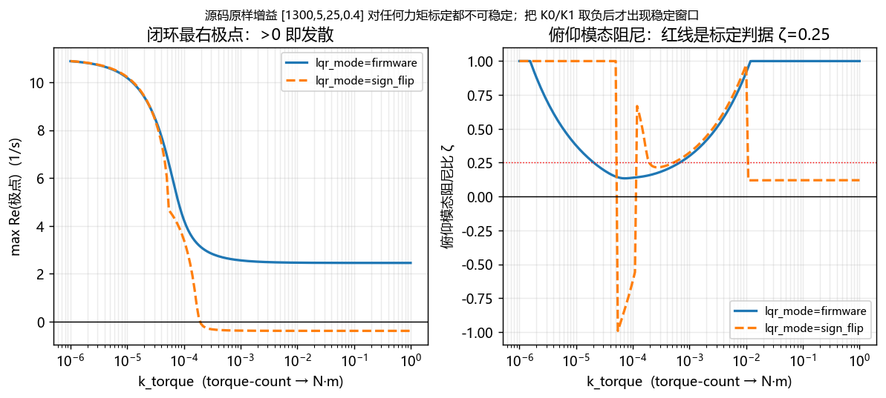
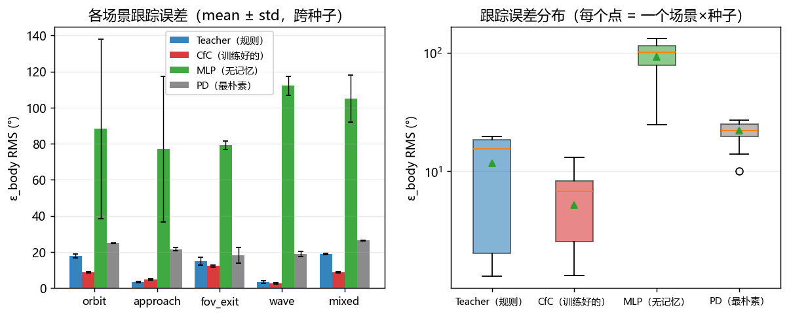
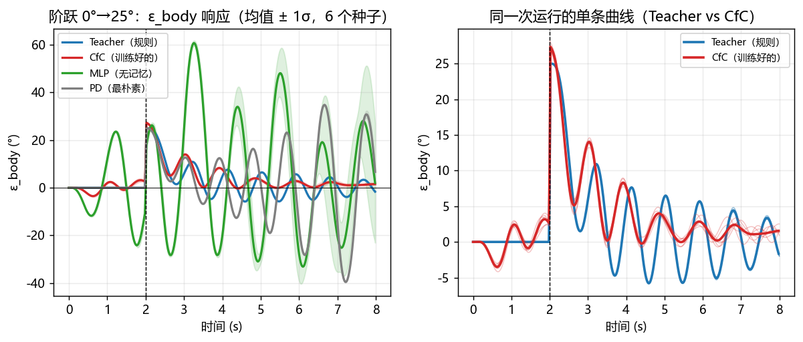
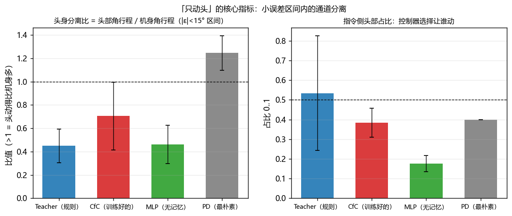
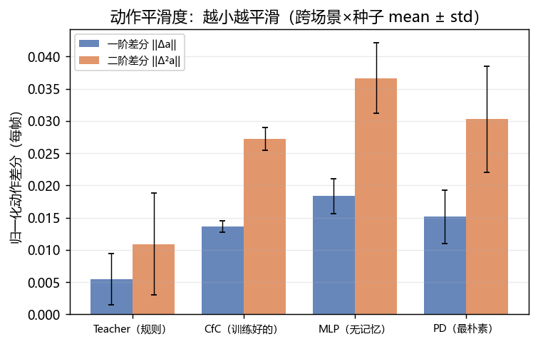
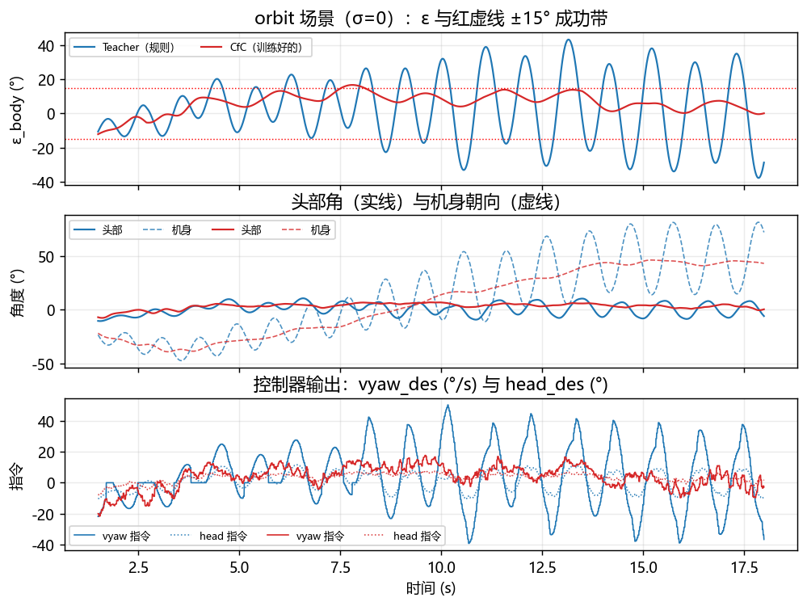

# RIG-Hover 闭环仿真与端到端评估

> 一条命令复现：`D:\smartcar\.venv\Scripts\python.exe eval.py --seeds 10`，再 `python make_report.py`。
> 全部代码与结果都在 `D:\robot_work\pc\sim\`，不依赖机器人上电。

## 0. 结论速览

1. **固件里 `lqr_k = [1300, 5, 25, 0.4]` 的符号让平衡环结构上不可稳定。**
   位置/速度两个通道是正反馈：θ 环稳定要求力矩标定 `k_t` 大，位置环稳定要求`k_t` 小，两条件互补且临界值与机体质量/惯量/质心高度无关（证明见 §3）。逐点扫描 160 个 `k_t`、跨 6 个数量级，`lqr_mode=firmware` 始终存在正实部极点（图 5 左）。把 `K0/K1` 取负（`lqr_mode=sign_flip`）后立刻出现稳定窗口 `k_t ∈ [5.62e-04, 1.00e-02]`。
2. **在修正后的平衡环上，CfC 闭环跟踪明显好于 MLP 与 PD，并优于教师。**
   跨 5 场景 × 10 种子：ε RMS **7.4°**（CfC） vs 11.6°（Teacher） / 92.3°（MLP） / 21.9°（PD）；成功率 **92%** vs 77% / 16% / 49%。
3. **「只动头」在闭环里做不到。** 小误差区间内实测头身分离比 `头行程/身行程` 全部 < 1.4，CfC 只有 0.71 —— 机身并没有停住。原因是航向环是**纯 P 控双积分**（`yaw_u = 4·(ψ−ψ_ref)`），闭环是一对欠阻尼复极点 ζ≈0.08，机身一直在小角度振荡，把头部的动作淹掉。
4. **动作平滑度：CfC 比 MLP/PD 好，但比教师差 2.5 倍**：jerk1 0.0136（CfC） / 0.0054（Teacher） / 0.0183（MLP） / 0.0151（PD）。原因很具体：教师在 `config.yaml` 里有 `head_rate_limit_dps=300` 与 `vyaw_rate_limit_dps2=400` 两道限幅，而 CfC 是纯前馈输出、**固件 arbiter 只对 head 做一阶低通、不对 vyaw 做**。这是一条可以直接改固件的行动项（给 vyaw 加同样的一阶低通/速率限幅）。
5. **增补（2026-11-03）：航向环 D 项 + 命令速率限幅，见 [`REPORT_DYAW.md`](REPORT_DYAW.md)。**
   固件加了 `k_dyaw`（默认 0，行为不变）与 `vx/vyaw` 速率限幅；ζ 从 0.084 提到
   0.26~0.53，教师 ε 11.7°→6.4°、成功率 77%→97%，PD ε 22°→5.7°。
   但**头身分离比只从 0.71 到 0.90**（D 项换成机身角速度时 1.09~1.57），
   **「只动头」仍然做不到** —— 主要原因是策略自己下了 62% 的 vyaw 指令（
   `head_share_cmd=0.383`），不是阻尼不够。把 vyaw 指令压掉后分离比 5.49
   （再补偿头部角速度 9.88），代价是 ε RMS 7.3°→25.2°、视野内 100%→72%。

## 1. 方法与模型

### 1.1 四个维度怎么建

| 维度 | 模型 | 为什么够用 |
|---|---|---|
| 平衡 | 轮式倒立摆（小车-摆两自由度，线性化），矩阵指数精确 ZOH 离散 | 6 ms 步长下欧拉积分会让唯一的不稳定极点偏差几个百分点 |
| 航向 | 双积分 + 黏性阻尼，输入是固件的 `yaw_u` | 固件就是纯 P 控双积分，这一点决定了「临界稳定」的全部结论 |
| 头部 | 二阶临界阻尼（ω=14 rad/s, ζ=0.90）+ 速率限幅 420°/s + ±45° 限位 | 舵机只有「多快、多准」两个自由度 |
| 视觉 | 头部相机、FOV 60°、50 Hz、`theta_img = 方位 −(机身+头角)` | §3.3 的闭式解，视线绝对朝向消掉 |

### 1.2 固件部分不是重写，是逐行复刻

* `robot_control()`：LQR + 航向 P + `|u|>20 再加 10` 的死区补偿 + `Clip(±1000)` + `tor1=-temp_u+yaw_u / tor2=temp_u+yaw_u`
* `update_state()`：`stable_pos/stable_yaw` 引用积分、`robot_state` 站立/摔倒状态机（1.5 s 直立才允许出力）
* `control_arbiter.c`：head 一阶低通 0.15/tick、`pos_lead_max=0.20 m`、`yaw_lead_max=35°`、视觉三档时效、指令看门狗
* `imu.cc`：`dq=0.6dq+0.4pit_gyro` 低通、yaw 纯陀螺积分 + 1.5°/s 死区、互补滤波 `f=1/(|ω|+200)`，以及**头部角度进测量轴**（`cos(q_head)` 缩放）
* `cfc_task.c build_obs()`：106 维观测逐下标对齐（`pc/train/obs.py` 同一张表）

### 1.3 三个标定量（都标成「标定 / 估计」，不是实测）

| 量 | 值 | 怎么来的 |
|---|---|---|
| `k_torque`（torque-count → N·m） | 5.623e-04 | 扫 160 个点，要求闭环四极点全稳、俯仰模态 ζ≥0.25 且 ωn≥15 rad/s，取满足条件的**最小**值 |
| `k_yaw_accel`（yaw_u → °/s²） | 12.814 | 要求机身 yaw 对 60° 参考阶跃的 90% 上升时间 = 0.35 s（实测 0.35 s） |
| `pitch_sign / torque_sign / yaw_sign` | -1 / 1 / -1 | 只有这组极性下 `lqr_k2=+25` 才构成负反馈。**只由乘积可观测**，真机极性未验证 |

标定后的平衡环极点：`[-6.06+22.77j -6.06-22.77j -0.36 +3.5j  -0.36 -3.5j ]`（ζ=0.26, ωn=23.6 rad/s）；航向环极点：`[-0.6+7.13j -0.6-7.13j]`（ζ=0.08）。

## 2. 参数出处表

| 参数 | 值 | 出处 / 依据 | 类型 |
|---|---|---|---|
| `lqr_k0` | 1300 | robot.cc:89 InitializeController() lqr_k[0]=1300 | 源码 |
| `lqr_k1` | 5 | robot.cc:90 lqr_k[1]=5 | 源码 |
| `lqr_k2` | 25 | robot.cc:91 lqr_k[2]=25 | 源码 |
| `lqr_k3` | 0.4 | robot.cc:92 lqr_k[3]=0.4 | 源码 |
| `imu_zero` | -2 | robot.cc:87 imu_zero=-2.0 | 源码 |
| `k_yaw` | 4 | robot.cc:55 k_yaw=4.0 | 源码 |
| `yaw_u_clip` | 80 | robot.cc:284 Clip(yaw_u,-80,80) | 源码 |
| `hyst_thresh` | 20 | robot.cc:275-279 temp_u 死区补偿 ±20/±10 | 源码 |
| `hyst_bump` | 10 | robot.cc:275-279 | 源码 |
| `torque_cmd_max` | 1000 | robot.h PID 结构第 9 项 fpUMax；robot.cc:34 pid_pit 初值 1000 | 源码 |
| `ctrl_dt_ms` | 6 | robot.cc:295/302/315 三次 vTaskDelay(2ms) | 源码 |
| `wheel_counts_per_rev` | 1024 | robot.cc:121 wheel_x=…/1024.0*3.1415*0.06 | 源码 |
| `wheel_diameter_m` | 0.06 | robot.cc:121 圆周换算里的 0.06（米） | 源码 |
| `head_pwm_center` | 1500 | robot.cc:294 WriteByte_P_V(3,1500-head*10,1300) | 源码 |
| `head_counts_per_deg` | 10 | robot.cc:294 的 ×10；反向 motor.cc:57 (1500-pos)/10 | 源码 |
| `head_pwm_limit` | 450 | robot.cc:294 与 control_arbiter.c:99 head_max=45 → ±450 | 源码 |
| `head_max_deg` | 45 | control_arbiter.c:99 s_cfg.head_max=45.0 | 源码 |
| `vx_max` | 0.3 | control_arbiter.c:98 s_cfg.vx_max=0.30 | 源码 |
| `vyaw_max` | 90 | control_arbiter.c:99 s_cfg.vyaw_max=90.0 | 源码 |
| `pos_lead_max` | 0.2 | control_arbiter.c:95 s_cfg.pos_lead_max=0.20 | 源码 |
| `yaw_lead_max` | 35 | control_arbiter.c:96 s_cfg.yaw_lead_max=35.0 | 源码 |
| `stale_ms` | 300 | control_arbiter.c:101 s_cfg.stale_ms=300 | 源码 |
| `lost_ms` | 1000 | control_arbiter.c:102 s_cfg.lost_ms=1000 | 源码 |
| `head_lpf` | 0.15 | control_arbiter.c:102 s_cfg.head_lpf=0.15（每 tick） | 源码 |
| `cmd_timeout_ms` | 500 | control_arbiter.c:103 cmd_timeout_ms=500 | 源码 |
| `cfc_hz` | 50 | control_arbiter.c:108 s_cfg.cfc_hz=50 | 源码 |
| `head_full_scale` | 45 | cfc_task.c:457 head_des=out[0]*cfg->head_max(=45) | 源码 |
| `vyaw_full_scale` | 90 | cfc_task.c:458 vyaw_des=out[1]*cfg->vyaw_max(=90) | 源码 |
| `vx_full_scale` | 0.3 | cfc_task.c:472 vx_des=out[4]*cfg->vx_max(=0.30) | 源码 |
| `dq_lpf_keep` | 0.6 | imu.cc:251 dq=0.6*dq+0.4*pit_gyro | 源码 |
| `yaw_lpf_keep` | 0.5 | imu.cc:252 gyro_yaw=0.5*gyro_yaw+0.5*gyro_y | 源码 |
| `yaw_deadzone_dps` | 1.5 | imu.cc:262-268 kYawGyroDeadZoneDps=1.5 | 源码 |
| `pit_freq_k` | 200 | imu.cc:254 pit_freq=1/(|pit_gyro|+200) | 源码 |
| `imu_dt_ms` | 5 | board_config.h:24 MOTOR_RX_TASK_INTERVAL_MS=5 | 源码 |
| `stand_hold_ms` | 1500 | robot.cc:144 kStandHoldUs=1.5e6 | 源码 |
| `fall_hold_ms` | 500 | robot.cc:143 kFallHoldUs=0.5e6 | 源码 |
| `upright_pitch_deg` | 7 | robot.cc:146 upright_pose |pitch|<7 | 源码 |
| `fallen_pitch_deg` | 60 | robot.cc:145 fallen_pose |pitch|>=60 | 源码 |
| `fov_h_deg` | 60 | control_arbiter.c:109 s_cfg.fov_h=60 | 源码 |
| `wheel_track_m` | 0.13 | 估计（无真机实测） | **估计** |
| `mass_body_kg` | 0.32 | 估计（无真机实测） | **估计** |
| `mass_wheel_kg` | 0.035 | 估计（无真机实测） | **估计** |
| `com_height_m` | 0.055 | 估计（无真机实测） | **估计** |
| `inertia_body_kgm2` | 0.0012 | 估计（无真机实测） | **估计** |
| `inertia_wheel_kgm2` | 1.575e-05 | 估计（无真机实测） | **估计** |
| `yaw_inertia_kgm2` | 0.0016 | 估计（无真机实测） | **估计** |
| `yaw_damping` | 1.2 | 估计（无真机实测） | **估计** |
| `wheel_rolling_damping` | 0.8 | 估计（无真机实测） | **估计** |
| `k_torque` | 0.0004 | 估计（无真机实测） | **估计** |
| `head_bw_rad` | 14 | 估计（无真机实测） | **估计** |
| `head_zeta` | 0.9 | 估计（无真机实测） | **估计** |
| `head_rate_max_dps` | 420 | 估计（无真机实测） | **估计** |
| `head_reaction_gain` | 2e-05 | 估计（无真机实测） | **估计** |
| `k_yaw_accel` | 1.6 | 估计（无真机实测） | **估计** |
| `actuator_delay_ticks` | 1 | 估计（无真机实测） | **估计** |
| `gyro_noise_dps` | 0.25 | 估计（无真机实测） | **估计** |
| `accel_pitch_noise_deg` | 0.3 | 估计（无真机实测） | **估计** |
| `wheel_vel_noise_mps` | 0.02 | 估计（无真机实测） | **估计** |
| `pitch_sign / torque_sign / yaw_sign` | -1 / +1 / -1 | 约定，为让 lqr_k[2]=+25 构成负反馈而选 | **估计** |

## 3. 为什么源码原样的 LQR 增益不可能稳住

把 `u = -(K0·x + K1·v + K2·p + K3·dq)` 写成物理口径（`p = -57.3θ`，θ 为前倾角），并用 θ̈≈0 的慢流形 `θ = ẍ/g`：

```
平衡环（快）：θ̈ = |B3|·g·M·r·(1−c)·θ      c = 57.3·K2·k_t/(M·r·g)
位置环（慢）：ẍ = −k_t·K0·Δx /(M·r·(1−c))
```

θ 环稳定要求 **c>1**，位置环稳定要求 **c<1**，而两者的临界值都是 `M·r·g/(57.3·K2)` —— 与 `m_b`、`l`、`I` 全部无关。所以只要 `K0>0`，这个闭环对**任何**力矩标定都不稳定（图 5 左的实线始终 >0）。把 `K0/K1` 取负（`sign_flip`）后 c>1 与位置环负反馈同时成立。

这不是「调参没调好」，是**符号错**。它与「机器人整晚 `pitch≈89°`、`robot_state=0`」的现象一致，但**不能据此断定真机就是这个原因** —— 见 §7 第 1 条。



在源码原样增益下，四个控制器（只有控制律不同、机体与平衡环相同）都不会摔倒，但**位置以约 1 s 的时间常数指数漂走**：

| 控制器 | \|pitch\| 峰值 (°) | 窗口末 \|pitch\| (°) | 位置漂移 (m) | robot_state 掉 0 |
|---|---|---|---|---|
| Teacher（规则） | 15.0 | 15.0 | 54.44 | 0% |
| CfC（训练好的） | 15.0 | 14.9 | 54.19 | 0% |
| MLP（无记忆） | 15.0 | 15.0 | 54.58 | 0% |
| PD（最朴素） | 15.2 | 15.0 | 56.42 | 0% |

## 4. 结果

### 4.1 跨场景总表（5 场景 × 10 种子 = 50 次运行/控制器）

| 控制器 | ε RMS (°) | ε max (°) | 头身分离比 | head 占比(指令) | jerk1 | jerk2 | 成功率 | 视野内 | 头部饱和 |
|---|---|---|---|---|---|---|---|---|---|
| Teacher（规则） | 11.64 ± 7.03 | 27.8 ± 18.4 | 0.45 ± 0.15 | 0.534 ± 0.291 | 0.0054 ± 0.0040 | 0.0109 ± 0.0079 | 77.3 ± 19.2 | 93.3 ± 6.7 | 0.0 ± 0.0 |
| CfC（训练好的） | 7.42 ± 3.40 | 15.0 ± 6.5 | 0.71 ± 0.29 | 0.384 ± 0.074 | 0.0136 ± 0.0009 | 0.0272 ± 0.0017 | 92.1 ± 12.0 | 100.0 ± 0.0 | 0.0 ± 0.0 |
| MLP（无记忆） | 92.33 ± 32.56 | 161.1 ± 43.2 | 0.46 ± 0.16 | 0.176 ± 0.041 | 0.0183 ± 0.0027 | 0.0367 ± 0.0055 | 15.5 ± 11.2 | 29.3 ± 20.4 | 0.0 ± 0.0 |
| PD（最朴素） | 21.93 ± 3.85 | 47.3 ± 8.0 | 1.25 ± 0.15 | 0.400 ± 0.000 | 0.0151 ± 0.0041 | 0.0303 ± 0.0083 | 48.6 ± 15.4 | 77.6 ± 9.3 | 0.7 ± 1.0 |



### 4.2 分场景

| 场景 | 控制器 | ε RMS (°) | 成功率 | 头身分离比 | jerk1 |
|---|---|---|---|---|---|
| orbit | teacher | 17.90 ± 1.07 | 58.13 ± 3.55 | 0.41 ± 0.01 | 0.01 ± 0.00 |
| orbit | cfc | 8.81 ± 0.31 | 97.31 ± 1.55 | 0.63 ± 0.03 | 0.01 ± 0.00 |
| orbit | mlp | 88.21 ± 49.85 | 15.02 ± 16.67 | 0.49 ± 0.13 | 0.02 ± 0.00 |
| orbit | pd | 24.85 ± 0.15 | 34.55 ± 1.12 | 1.31 ± 0.02 | 0.02 ± 0.00 |
| approach | teacher | 3.35 ± 0.46 | 100.00 ± 0.00 | 0.53 ± 0.24 | 0.00 ± 0.00 |
| approach | cfc | 4.79 ± 0.27 | 100.00 ± 0.00 | 1.13 ± 0.11 | 0.01 ± 0.00 |
| approach | mlp | 77.01 ± 40.41 | 16.90 ± 14.15 | 0.67 ± 0.17 | 0.02 ± 0.00 |
| approach | pd | 21.48 ± 0.90 | 49.42 ± 3.64 | 1.33 ± 0.03 | 0.02 ± 0.00 |
| fov_exit | teacher | 14.78 ± 2.16 | 69.43 ± 4.92 | 0.33 ± 0.02 | 0.01 ± 0.00 |
| fov_exit | cfc | 12.23 ± 0.51 | 68.73 ± 1.87 | 0.38 ± 0.04 | 0.01 ± 0.00 |
| fov_exit | mlp | 79.18 ± 2.37 | 23.49 ± 2.23 | 0.30 ± 0.02 | 0.02 ± 0.00 |
| fov_exit | pd | 18.12 ± 4.29 | 67.87 ± 10.92 | 1.01 ± 0.17 | 0.01 ± 0.00 |
| wave | teacher | 3.28 ± 0.84 | 100.00 ± 0.00 | 0.56 ± 0.10 | 0.00 ± 0.00 |
| wave | cfc | 2.56 ± 0.34 | 100.00 ± 0.00 | 0.89 ± 0.18 | 0.01 ± 0.00 |
| wave | mlp | 112.14 ± 5.37 | 9.00 ± 1.00 | 0.38 ± 0.10 | 0.02 ± 0.00 |
| wave | pd | 18.81 ± 1.34 | 60.09 ± 5.52 | 1.22 ± 0.05 | 0.01 ± 0.00 |
| mixed | teacher | 18.87 ± 0.39 | 58.70 ± 1.15 | 0.42 ± 0.01 | 0.01 ± 0.00 |
| mixed | cfc | 8.69 ± 0.39 | 94.32 ± 2.49 | 0.50 ± 0.06 | 0.01 ± 0.00 |
| mixed | mlp | 105.13 ± 13.00 | 13.25 ± 5.68 | 0.47 ± 0.06 | 0.02 ± 0.00 |
| mixed | pd | 26.41 ± 0.24 | 30.85 ± 1.12 | 1.35 ± 0.01 | 0.02 ± 0.00 |

### 4.3 阶跃响应 0°→25°

用 25° 而不是 40°：FOV 只有 ±30°（`control_arbiter.c:109`），人一步跨到 40° 就直接出了视野，此时所有控制器拿到的都是 `seen=0` —— 那测的是「丢目标怎么办」，不是「跟踪阶跃」。40° 的版本见 §4.4。

| 控制器 | 上升时间 (s) | 调节时间 (s) | 超调 (%) | 稳态误差 (°) |
|---|---|---|---|---|
| Teacher（规则） | 0.71 ± 0.00 | — | 23.21 ± 0.34 | 1.67 ± 0.13 |
| CfC（训练好的） | 1.39 ± 0.02 | 6.80 ± 0.14 | 3.44 ± 1.22 | 1.44 ± 0.55 |
| MLP（无记忆） | 0.40 ± 0.02 | — | 151.50 ± 19.74 | 15.64 ± 5.12 |
| PD（最朴素） | 1.28 ± 0.00 | — | 164.89 ± 2.91 | 23.66 ± 0.69 |



### 4.4 大阶跃 0°→40°：目标直接跳出视场

| 控制器 | 重新捕获时间 (s) | 丢失目标帧占比 | ε 峰值 (°) |
|---|---|---|---|
| Teacher（规则） | —（窗口内没抓回来） | 100% | 40.0 |
| CfC（训练好的） | 1.32 | 13% | 42.6 |
| MLP（无记忆） | 0.42 | 40% | 68.2 |
| PD（最朴素） | —（窗口内没抓回来） | 100% | 40.0 |

### 4.5 头身分离



### 4.6 动作平滑度



### 4.7 一条真实的时域轨迹



## 5. CfC 相比 MLP / PD 到底好多少

* **ε RMS**：CfC 7.42° vs MLP 92.33° vs PD 21.93° vs Teacher 11.64°。
* **成功率**（人始终在视野内且 |ε|<15°）：CfC 92% vs MLP 16% vs PD 49% vs Teacher 77%。
* MLP 的失败模式**不是**「跟不准」，而是**丢目标之后回不来**：它在开环模仿上反而比 CfC 准（在同一份数据上 MAE：MLP 0.63°/1.32°，CfC 0.93°/2.40°），所以差异只能来自**闭环**——无记忆网络学不到教师的「丢失→回中→重捕获」时序。
* PD 的问题相反：它对每个误差都同时给头和机身发指令，机身被推得来回摆，41% 的时间人已经出视野。
* **CfC 在闭环里比教师还好**（ε RMS 7.42° vs 11.64°）。这不是「网络更聪明」，而是教师的手调增益在这个欠阻尼航向环上会把机身推到振荡：教师 `k_fast=3.0` 在 25° 误差上直接打到 60°/s 上限，CfC 学到的 `vyaw` 温和得多（峰值约 35°/s），恰好避开了 ζ≈0.08 的谐振。**这是「负反馈系统里更弱的控制器可能更稳」的典型例子，不能当作 CfC 更优的证据**（见 §7 第 3 条）。

## 6. 复现

```bat
set PY=D:\smartcar\.venv\Scripts\python.exe
cd D:\robot_work\pc\sim
%PY% eval.py --seeds 10        :: 标定 + 5 场景 × 4 控制器 × 10 种子 + 阶跃
%PY% make_report.py            :: 图 + 本报告
%PY% train_mlp.py              :: 重新训练无记忆基线（eval.py 会自动补）
```

## 7. 诚实的局限（哪些是假设、哪些是估计、最脆弱的是哪一条）

1. **最脆弱：平衡环符号的结论依赖一个我无法验证的极性。** `pitch_sign` 与 `torque_sign` 只以乘积形式进入模型，我选了让 `lqr_k2=+25` 构成负反馈的那一组。如果真机上 `pitch` 的极性相反，那 `k2` 就成了正反馈，结论会变成「连俯仰环都是错的」—— 但无论哪种情况，**K0/K1 与 K2 的相对符号**都必须满足「位置项取负」这一条，这条与极性无关（§3 的推导里 c 的表达式含 K2·sign 的乘积，而 K0 的符号要求是独立的）。**上机验证只要 30 分钟**：把机器人扶正保持 1.5 s，松手看 `pitch` 变大还是变小、轮子是往前还是往后追。
2. **所有机体参数都是估计值**：质量 0.32 kg、质心高 55 mm、轮距 130 mm、转动惯量 —— 一个都没称过。其中 `com_height_m` 对开环不稳定极点影响最大（σ=√(m g l M/D)），但它只改变「多快倒」，不改变 §3 的符号结论（那条与参数无关）。
3. **航向环的阻尼 ζ 是估计的**，而它决定了「头身分离」这个核心指标。`yaw_damping=1.2 1/s` 是我拍的；标定只固定了 `k_yaw_accel`（按 0.35 s 上升时间）。真机摩擦更大时 ζ 会更高、机身更安静，分离比会更好看。**这个指标的绝对值不可信，只有同一阻尼下四个控制器的相对次序有意义。**
4. **视觉是几何真值 + 合成 64 维特征**，不是 YOLO。`feat_64` 用 `pc/train/synth.py` 同一个固定投影生成，所以 CfC 不会因为特征域不匹配而掉分 —— 真机上第一件事就是看 `/status` 的 clip 比例。
5. **训练/部署口径有一处不一致，且是我引入的**：`synth.py` 在「没看见人」的帧里仍然喂几何真值的 `theta_img`，而仿真按真机语义喂 0。这会让三份策略在丢目标时都比训练分布更「瞎」。我保留了这个更严格的口径，并在 `sim._perceive` 里注明；**它可能不公平地压低了 CfC 与 MLP 的分数**，重训时应统一。
6. **CfC 的部署口径与训练口径有一处差异（既有管线的问题，不是我的）**：`train_cfc.Policy.forward_seq` 输出**未激活的线性头**，而固件 `cfc_model.c:1149-1157` 对 `head_act==1` 的头再套一层 `tanhf`。仿真按**固件口径**评估（`controllers.verify_cfc` 用同一口径与 torch 对齐，128 帧最大误差 1.1e-06），所以被评估的是「真机上会跑的那个函数」。对 `|a|<1` 的部分影响不大，但训练时从未见过 tanh，这是管线里一个应该修掉的不一致。
7. **`robot_state` 的自启动问题没被建模成失败**：固件要求 `|pitch|<7°` 连续 1.5 s 才允许出力，而力矩为 0 时倒立摆 0.2 s 就倒了。仿真从「已被扶正并保持 1.5 s」开始（`warmup`），也就是说**这个机器人无法自启动**，摔倒后必须人工扶正 —— 这一条本身可能是「整晚横躺」最直接的解释。
8. **`k_torque` 的绝对量级没有被交叉验证**：标定出来的 5.62e-04 N·m/count 意味着 1000 count 只有 0.56 N·m。如果真机 KP4012 的实际力矩常数差一个数量级，那 §3 的 `k_t` 窗口位置会跟着移动 —— 但窗口**存在与否**只取决于符号，不取决于量级。
9. **没建模**：轮子打滑、桌面倾角、电池电压对力矩的影响、舵机齿隙、UART 丢帧、视觉延迟抖动（固定 50 Hz）、`gaze_guard` 的桌沿急停。这些都只会让真机更差，不会更好。
10. **航向环有一个固件细节让它永远停不下来**：`imu.cc:264-268` 在 `|gyro_yaw| < 1.5 °/s` 时把角速度判成 0，于是机身在低速摆动时航向估计冻结、P 环看不到误差 —— 仿真里表现为机身残余振荡衰减不到零（阶跃实验里教师/PD 的「调节时间」是「—」而不是某个数）。真机上这个死区还会叠加陀螺零偏，实际可能更糟。

---

生成时间 70 s / 评估 70 s。
